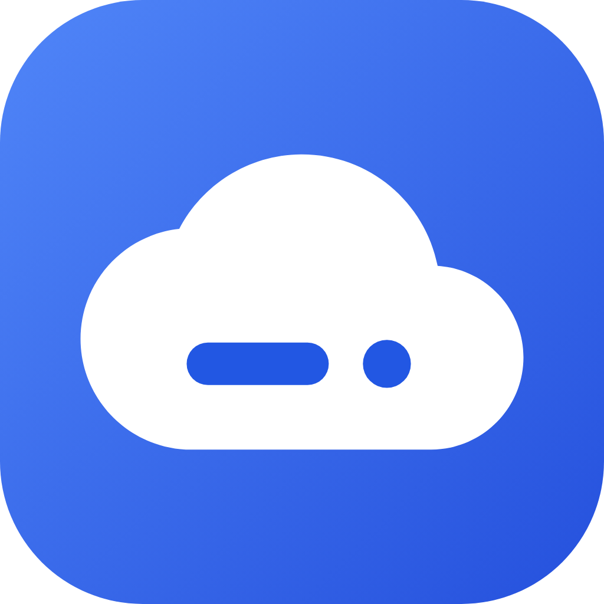
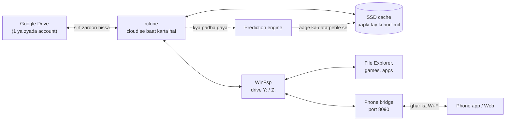
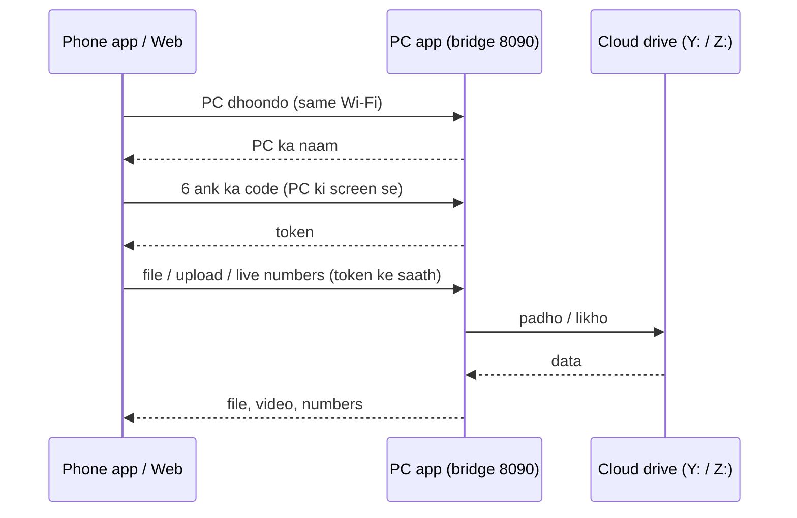
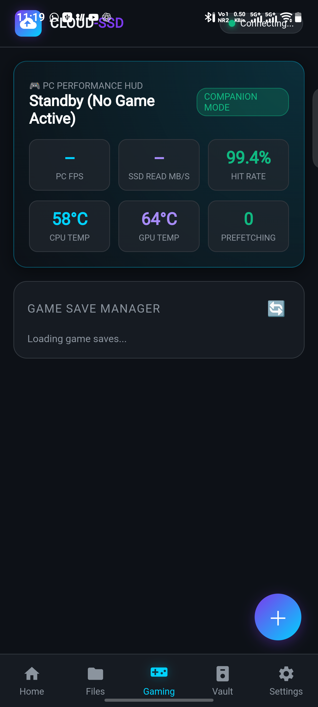
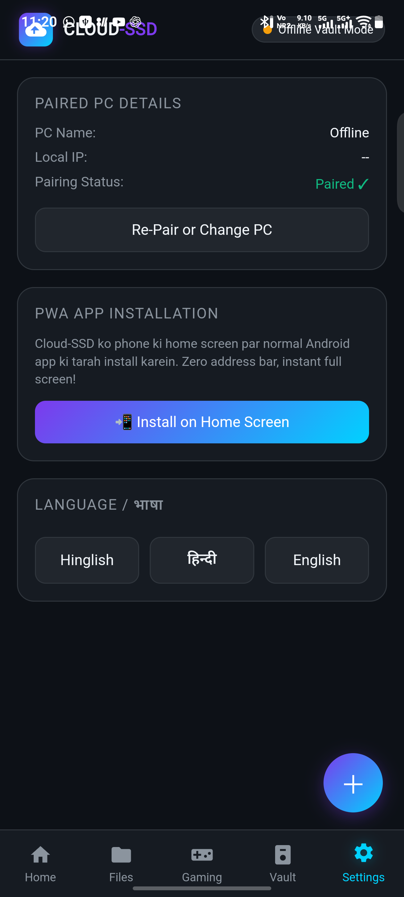
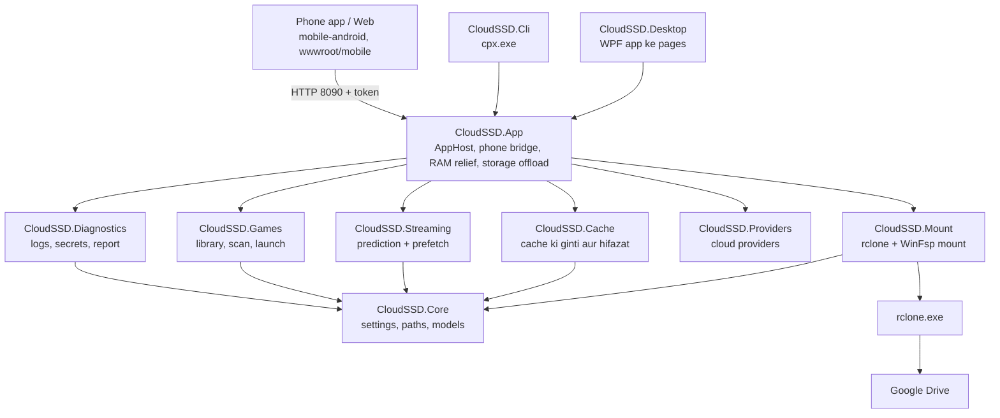

<div align="center">



# Cloud Drive (Cloud-SSD)

**Apni Google Drive ko PC ki asli drive bana lo — aur phone se bhi chalao.**

Bade games aur files cloud me rakho, PC ki SSD khali rakho, aur `Z:` drive se aise kholo jaise file PC me hi rakhi ho.

[](#setup)
[](#phone)
[](#architecture)
[](#kaise)
[](#download)
[](#download)
[](Cloud-SSD/Cloud-SSD-0.7.0-source/Cloud-SSD/LICENSE)

[Kya hai](#kya) • [Kaise kaam karta hai](#kaise) • [Features](#features) • [Phone & Web](#phone) • [Photo](#photo) • [Download](#download) • [Setup](#setup) • [Architecture](#architecture) • [Folder map](#structure) • [Docs](#docs) • [Sujhav bhejein](#sujhav)

</div>

---

<a id="kya"></a>

## 🧐 Yeh app kya karta hai

Cloud Drive aapke **Google Drive account** ko Windows me ek **asli drive letter** (`Y:` / `Z:`) bana kar jod deta hai. File Explorer, games aur baki apps ko wo ek normal hard disk jaisi dikhti hai.

| Aapki dikkat | Cloud Drive kya karta hai |
|---|---|
| PC ki SSD bhar gayi hai | Files cloud me rehti hain; PC par sirf wahi hissa aata hai jo abhi chahiye |
| 100 GB ka game pura download karna padta hai | Game sirf wahi tukde download karta hai jo wo padh raha hai |
| Ek Google account me jagah kam hai | Kai account jod kar **ek badi drive** ban jaati hai |
| Phone me storage kam hai | Phone se photo / file seedhe cloud drive me bhej do |
| PC ki files phone par chahiye | Phone app ya browser se cloud drive kholo, video seedhe chalao |

> **Yeh cloud gaming nahi hai.** Game aapke hi PC ke CPU aur GPU par chalta hai. Cloud Drive sirf *storage* ko cloud se jodta hai — video stream nahi karta.

---

<a id="kaise"></a>

## ⚙️ Kaise kaam karta hai



1. **rclone** Google Drive se baat karta hai. Poori file nahi, sirf maanga hua hissa (byte range) download hota hai.
2. **WinFsp** us data ko Windows me ek drive letter ki tarah dikhata hai. Koi kernel driver nahi, admin rights sirf WinFsp install ke waqt.
3. Jo hissa ek baar aa gaya wo **SSD cache** me reh jaata hai, to dobara kholne par turant khulta hai. Cache ki limit aap tay karte ho, aur C: par hamesha kuch jagah bachi rehti hai.
4. **Prediction engine** dekhta hai ki game kis kram me kya padhta hai, aur agli baar wo data pehle se la kar rakhta hai ("Optimize & Prepare").
5. **Phone bridge** PC par ek chhota local server hai. Phone app aur web page isi se judte hain — sirf aapke Wi-Fi ke andar, kisi bahar ke server ke bina.

---

<a id="features"></a>

## ✨ Features

### 💻 PC app (Windows)

| Feature | Kya milta hai |
|---|---|
| **Do cloud drive** | **Each Account** (`Y:`) — har Google account ka alag folder. **All Accounts** (`Z:`) — sab account jud kar ek badi drive |
| **Kai account** | Jitne Google account chahein jodein; har account apni Gmail aur bachi hui jagah ke saath dikhta hai |
| **Smart Cache** | Cache ki limit, C: ke liye surakshit jagah, aur sirf padha hua hissa hi disk par (sparse file) |
| **Game Library** | 3 tareeke: **Cloud Direct** (seedha drive se), **Hybrid** (exe/dll PC par, bada data cloud se), **Full Local** (pura copy) |
| **Optimize & Prepare** | Game shuru karne se pehle uska startup data pehle hi download kar leta hai |
| **PC Memory (RAM)** | RAM ka haal dikhata hai; jab 30% se kam RAM bache to idle background apps ki RAM khud khali karta hai |
| **Storage auto mode** | PC par jagah kam ho to phone se aayi uploads cloud drive me chali jaati hain |
| **Mobile Hub** | Phone jodne ka code / QR, jude hue phone ki list, kya-kya allow hai uske switch |
| **Diagnostics** | Zaroori cheezon ka status, logs, aur ek "safe report" jisme login / token nahi hote |
| **Bhasha** | Hinglish, हिन्दी, English |
| **`cpx` command** | Bina window ke check aur mount: `cpx deps`, `cpx remotes`, `cpx mounts` |

### 🔒 Suraksha

- Google password app me kabhi nahi likha jaata — sign-in Google ke apne page par hota hai.
- Saved login PC par encrypt ho kar rehta hai (Windows DPAPI).
- Phone bridge sirf local Wi-Fi par sunta hai; har request me pairing ka token chahiye.
- App admin rights ke bina chalta hai aur Windows ki security settings nahi badalta.

---

<a id="phone"></a>

## 📱 Phone app aur 🌐 Web

Phone ke liye do raste hain, dono ek hi cheez dikhate hain:

| | **Android app** | **Web (browser)** |
|---|---|---|
| Kaise khulta hai | APK install karke | Browser me `http://<PC-IP>:8090` |
| Kis par chalta hai | Android 7.0+ | Koi bhi phone, tablet ya dusra laptop — same Wi-Fi par |
| Home screen icon | Haan | Haan ("Install on Home Screen" — PWA) |
| Camera ka auto backup | Haan | Nahi |
| Phone ke Files app me cloud drive | Haan | Nahi |

### Phone se kya-kya kar sakte hain

| Hissa | Kaam |
|---|---|
| **Cloud SSD** | PC ki cloud drive browse karo, file kholo / download karo, naya folder banao, rename / move / delete |
| **Send to PC** | Photo ya koi bhi file phone se cloud drive me bhejo; transfer ki list dikhti hai |
| **Camera backup** | Naye photo / video apne aap `Phone Backup/<phone>/Camera/<saal-mahina>` me chale jaate hain |
| **Media** | Video aur audio bina pura download kiye seedhe chalte hain |
| **Gaming companion** | PC ke live number: CPU, GPU, RAM, cloud read MB/s, cache hits, Wi-Fi latency; game save ke backup |
| **PC media remote** | Mute, Previous, Play / Pause, Next |
| **Laptop Space Saver** | Phone se hi PC par jagah khali karwana |
| **This phone** | Phone ki RAM aur storage, phone ki files category ke hisaab se |
| **Bhasha** | Hinglish, हिन्दी, English |

### Phone PC se kaise judta hai



> **Dhyan rahe:** abhi phone **PC ke raste** kaam karta hai. PC app chalu hona chahiye aur phone usi Wi-Fi par hona chahiye. Bina PC ke seedha phone se cloud — yeh agla kaam hai, abhi nahi bana.

---

<a id="photo"></a>

## 📸 Photo

Phone app ke screenshot (thode purane version ke hain, naye version me layout badla hai):

<div align="center">

| Gaming HUD | Offline Vault | Settings |
|:---:|:---:|:---:|
|  |  |  |
| PC ke live number phone par | Phone me save ki hui files | Pairing, home-screen install, bhasha |

</div>

---

<a id="download"></a>

## 📥 Download

| Kis ke liye | File | Size |
|---|---|---|
| 💻 **Windows PC** | [`Cloud-SSD-0.7.0-setup.exe`](Cloud-SSD/Cloud-SSD-0.7.0-source/Cloud-SSD/releases/Cloud-SSD-0.7.0-setup.exe) | ~69 MB |
| 🔒 Setup ka checksum | [`Cloud-SSD-0.7.0-setup.exe.sha256`](Cloud-SSD/Cloud-SSD-0.7.0-source/Cloud-SSD/releases/Cloud-SSD-0.7.0-setup.exe.sha256) | — |
| 📱 **Android phone** | [`Cloud-SSD-Mobile.apk`](Cloud-SSD/Cloud-SSD-0.7.0-source/Cloud-SSD/mobile-android/Cloud-SSD-Mobile.apk) | ~1 MB |

Phone app PC app ke andar bhi rakha hota hai: PC app chalu ho to phone ke browser me `http://<PC-IP>:8090/cloudssd.apk` kholne se bhi mil jaata hai.

---

<a id="setup"></a>

## 🛠️ Setup

### Sabse aasan: AI agent se karwao

Poora setup — PC se phone tak — ek file me step by step likha hai: **[`SETUP.md`](Cloud-SSD/Cloud-SSD-0.7.0-source/Cloud-SSD/SETUP.md)**.
Apne AI agent (Claude Code, Antigravity, Codex…) ko project folder me khol kar yeh likh do:

```text
SETUP.md padho aur usme likha pura setup kar do — PC app, cloud drive aur phone app, sab.
Meri taraf se full permission hai. Jahan mera click chahiye wahan ek line me batao.
```

### Haath se: 3 + 3 step

**PC par**

1. [`Cloud-SSD-0.7.0-setup.exe`](Cloud-SSD/Cloud-SSD-0.7.0-source/Cloud-SSD/releases/Cloud-SSD-0.7.0-setup.exe) chalao. WinFsp ke liye Windows poochhe to **Yes**.
2. App kholo → **Cloud Drives** → **Sign in with Google** → browser me account chun kar **Allow**.
3. File Explorer me `Y:` aur `Z:` drive aa jaayengi. Bas.

**Phone par**

1. [APK](Cloud-SSD/Cloud-SSD-0.7.0-source/Cloud-SSD/mobile-android/Cloud-SSD-Mobile.apk) install karo (ya browser me `http://<PC-IP>:8090` kholo).
2. Phone aur PC ko **ek hi Wi-Fi** par rakho.
3. PC app ke **Mobile Hub** page par dikh raha **6 ank ka code** phone me daalo.

### Kya chahiye

| Cheez | Zaroorat |
|---|---|
| PC | Windows 10 (1809+) ya 11, 64-bit, NTFS drive |
| Google account | Kam se kam ek |
| Phone | Android 7.0+ (web ke liye koi bhi browser) |
| Wi-Fi | Phone aur PC ek hi network par |

Dikkat aaye to: [`SETUP.md` ka "Dikkat aaye to"](Cloud-SSD/Cloud-SSD-0.7.0-source/Cloud-SSD/SETUP.md#6-dikkat-aaye-to) aur [`docs/TROUBLESHOOTING.md`](Cloud-SSD/Cloud-SSD-0.7.0-source/Cloud-SSD/docs/TROUBLESHOOTING.md). Apni khud ki Google key banani ho to [`docs/GOOGLE_DRIVE_SETUP.md`](Cloud-SSD/Cloud-SSD-0.7.0-source/Cloud-SSD/docs/GOOGLE_DRIVE_SETUP.md).

<details>
<summary><b>Developer: source code se build</b></summary>

<br/>

```powershell
cd Cloud-SSD\Cloud-SSD-0.7.0-source\Cloud-SSD
powershell -ExecutionPolicy Bypass -File installer\fetch-rclone.ps1      # rclone laata hai (checksum ke saath)
dotnet build CloudSSD.slnx -c Release
dotnet test tests\CloudSSD.Tests -c Release --no-build                   # unit tests
powershell -ExecutionPolicy Bypass -File installer\build-release.ps1     # dist\ me zip + setup.exe
powershell -NoProfile -ExecutionPolicy Bypass -File mobile-android\build-apk.ps1   # phone ka APK
```

Chahiye: .NET SDK 10, WinFsp, (setup.exe ke liye) Inno Setup 6, (APK ke liye) Android SDK + JDK 17. Poori jaankari [`SETUP.md` ke Rasta B](Cloud-SSD/Cloud-SSD-0.7.0-source/Cloud-SSD/SETUP.md#4-rasta-b--source-code-se-build-developer--naya-build) me.

</details>

---

<a id="architecture"></a>

## 🏗️ Architecture

App **.NET 10 (C#)** me bana hai, UI **WPF + MVVM** hai. Neeche ke do tayyar tools par khada hai — **rclone** (cloud + cache) aur **WinFsp** (Windows drive) — aur unke upar apna dimaag jodta hai: mount sambhalna, cache ki hifazat, prediction, games, phone bridge.



| Project | Zimmedari |
|---|---|
| [`CloudSSD.Core`](Cloud-SSD/Cloud-SSD-0.7.0-source/Cloud-SSD/src/CloudSSD.Core) | Settings (JSON), raste, units, models, disk ki jaankari |
| [`CloudSSD.Mount`](Cloud-SSD/Cloud-SSD-0.7.0-source/Cloud-SSD/src/CloudSSD.Mount) | rclone dhoondna aur chalana, Google sign-in, drive lagana / hatana, crash par dobara chalana, rclone ka log padhna |
| [`CloudSSD.Cache`](Cloud-SSD/Cloud-SSD-0.7.0-source/Cloud-SSD/src/CloudSSD.Cache) | Cache me kya hai, disk kitni bachi, safe safai |
| [`CloudSSD.Streaming`](Cloud-SSD/Cloud-SSD-0.7.0-source/Cloud-SSD/src/CloudSSD.Streaming) | Predictors, prefetch queue, network governor, har game ka profile (SQLite) |
| [`CloudSSD.Games`](Cloud-SSD/Cloud-SSD-0.7.0-source/Cloud-SSD/src/CloudSSD.Games) | Game library, folder scan, compatibility, launcher, Hybrid / Full Local |
| [`CloudSSD.Providers`](Cloud-SSD/Cloud-SSD-0.7.0-source/Cloud-SSD/src/CloudSSD.Providers) | Kaun sa cloud kitna supported hai |
| [`CloudSSD.Diagnostics`](Cloud-SSD/Cloud-SSD-0.7.0-source/Cloud-SSD/src/CloudSSD.Diagnostics) | Logs, token chhupana, DPAPI secret store, report zip |
| [`CloudSSD.App`](Cloud-SSD/Cloud-SSD-0.7.0-source/Cloud-SSD/src/CloudSSD.App) | Sab ko jodne wala `AppHost`, phone bridge, RAM relief, storage offload |
| [`CloudSSD.Desktop`](Cloud-SSD/Cloud-SSD-0.7.0-source/Cloud-SSD/src/CloudSSD.Desktop) | WPF window, pages, theme, bhasha; phone ka web page bhi yahin se serve hota hai (`wwwroot/mobile`) |
| [`CloudSSD.Cli`](Cloud-SSD/Cloud-SSD-0.7.0-source/Cloud-SSD/src/CloudSSD.Cli) | `cpx.exe` command-line tool |
| [`CloudSSD.SimCloud`](Cloud-SSD/Cloud-SSD-0.7.0-source/Cloud-SSD/src/CloudSSD.SimCloud) | Test ke liye nakli "dheema cloud" server |
| [`mobile-android`](Cloud-SSD/Cloud-SSD-0.7.0-source/Cloud-SSD/mobile-android) | Android app (WebView + native: camera backup, Files app me cloud drive) |

Gehri jaankari: [`ARCHITECTURE.md`](Cloud-SSD/Cloud-SSD-0.7.0-source/Cloud-SSD/ARCHITECTURE.md).

### 📊 Kitna tez hai (napa hua)

Test: demo game ka ek level load, "cloud" 70 Mbps par. Poori report: [`BENCHMARKS.md`](Cloud-SSD/Cloud-SSD-0.7.0-source/Cloud-SSD/BENCHMARKS.md).

| Halat | Load time |
|---|---|
| PC ki SSD se (tulna ke liye) | 0.1 s |
| Seedha rclone mount, pehli baar | 56 – 65 s |
| **Cloud Drive, pehli baar** | **20 – 21 s** |
| **Cloud Drive, Prepare ke baad** | **7.7 – 8.2 s** |
| **Cloud Drive, sab cache me** | **0.15 – 0.27 s** |

### ⚠️ Sach-sach: kya nahi kar sakta

- Jo data cache me nahi hai wo **internet ki speed** se hi aayega — pehli baar SSD jaisa tez nahi hoga.
- Abhi tak sirf demo game se test hua hai, **koi bada commercial game test nahi hua**. Steam / Epic / anti-cheat wale games ko aam taur par local install chahiye.
- Phone abhi **PC ke bina** cloud tak nahi pahunchta.
- App par code-signing nahi hai, to Windows SmartScreen pehli baar chetavni de sakta hai.

Poori list: [`KNOWN_LIMITATIONS.md`](Cloud-SSD/Cloud-SSD-0.7.0-source/Cloud-SSD/KNOWN_LIMITATIONS.md).

---

<a id="structure"></a>

## 🗂️ Folder map (click karke seedhe wahan jao)

```text
Cloud-Drive
├── README.md                          ← aap yahan ho
├── Cloud-SSD
│   ├── Cloud-SSD-0.7.0-source.zip     purana source zip
│   └── Cloud-SSD-0.7.0-source
│       ├── Cloud-SSD                  ★ ASLI PROJECT (code yahan hai)
│       │   ├── src                    PC app ka code (CloudSSD.* projects)
│       │   ├── mobile-android         phone app ka code + APK
│       │   ├── tests                  unit + integration tests
│       │   ├── benchmarks             speed test
│       │   ├── installer              setup.exe banane ki scripts
│       │   ├── tools                  rclone, WinFsp installer, 5TB scripts
│       │   ├── docs                   guides
│       │   ├── releases               tayyar setup.exe aur APK
│       │   └── dist                   build ka output
│       └── Cloud-SSD-0.7.0-source     purani release files ki copy
└── Cloud-SSD-5TB                      purani PowerShell scripts (app se pehle wala tareeka)
```

| Jana hai | Link |
|---|---|
| ★ Asli project | [`Cloud-SSD/Cloud-SSD-0.7.0-source/Cloud-SSD`](Cloud-SSD/Cloud-SSD-0.7.0-source/Cloud-SSD) |
| PC app ka code | [`src`](Cloud-SSD/Cloud-SSD-0.7.0-source/Cloud-SSD/src) |
| Phone app ka code | [`mobile-android`](Cloud-SSD/Cloud-SSD-0.7.0-source/Cloud-SSD/mobile-android) |
| Phone ka web page | [`src/CloudSSD.Desktop/wwwroot/mobile`](Cloud-SSD/Cloud-SSD-0.7.0-source/Cloud-SSD/src/CloudSSD.Desktop/wwwroot/mobile) |
| Tests | [`tests`](Cloud-SSD/Cloud-SSD-0.7.0-source/Cloud-SSD/tests) |
| Installer scripts | [`installer`](Cloud-SSD/Cloud-SSD-0.7.0-source/Cloud-SSD/installer) |
| Tayyar downloads | [`releases`](Cloud-SSD/Cloud-SSD-0.7.0-source/Cloud-SSD/releases) |
| Purani 5TB scripts | [`Cloud-SSD-5TB`](Cloud-SSD-5TB) · [uska README](Cloud-SSD-5TB/README.md) |

---

<a id="docs"></a>

## 📚 Sab documents

| Document | Kis baare me |
|---|---|
| [`SETUP.md`](Cloud-SSD/Cloud-SSD-0.7.0-source/Cloud-SSD/SETUP.md) | **Poora setup, step by step** (AI agent ya haath se) |
| [`README.md` (project)](Cloud-SSD/Cloud-SSD-0.7.0-source/Cloud-SSD/README.md) | Project ka apna parichay |
| [`ARCHITECTURE.md`](Cloud-SSD/Cloud-SSD-0.7.0-source/Cloud-SSD/ARCHITECTURE.md) | Andar ka design, data kaise behta hai |
| [`BENCHMARKS.md`](Cloud-SSD/Cloud-SSD-0.7.0-source/Cloud-SSD/BENCHMARKS.md) | Speed ke naap |
| [`KNOWN_LIMITATIONS.md`](Cloud-SSD/Cloud-SSD-0.7.0-source/Cloud-SSD/KNOWN_LIMITATIONS.md) | Kya nahi hota, aur kyun |
| [`COMPATIBILITY.md`](Cloud-SSD/Cloud-SSD-0.7.0-source/Cloud-SSD/COMPATIBILITY.md) | Kaun se game / cloud chalte hain |
| [`RAM.md`](Cloud-SSD/Cloud-SSD-0.7.0-source/Cloud-SSD/RAM.md) | RAM aur virtual memory ka guide |
| [`docs/GOOGLE_DRIVE_SETUP.md`](Cloud-SSD/Cloud-SSD-0.7.0-source/Cloud-SSD/docs/GOOGLE_DRIVE_SETUP.md) | Google Drive jodna, apni key banana |
| [`docs/TROUBLESHOOTING.md`](Cloud-SSD/Cloud-SSD-0.7.0-source/Cloud-SSD/docs/TROUBLESHOOTING.md) | Dikkat aur uska ilaaj |
| [`docs/GAME_AWARE_PROTOCOL.md`](Cloud-SSD/Cloud-SSD-0.7.0-source/Cloud-SSD/docs/GAME_AWARE_PROTOCOL.md) | Game se seedhe jaankari lene ka protocol |
| [`SECURITY.md`](Cloud-SSD/Cloud-SSD-0.7.0-source/Cloud-SSD/SECURITY.md) | Suraksha ki neeti |
| [`CONTRIBUTING.md`](Cloud-SSD/Cloud-SSD-0.7.0-source/Cloud-SSD/CONTRIBUTING.md) | Code me haath bantana ho to |
| [`THIRD_PARTY_NOTICES.md`](Cloud-SSD/Cloud-SSD-0.7.0-source/Cloud-SSD/THIRD_PARTY_NOTICES.md) | rclone, WinFsp wagairah ke license |

---

<a id="sujhav"></a>

## 💬 Sujhav bhejein

<div align="center">
<table>
<tr>
<td align="center" width="640">

<h3>Kuch behtar ho sakta hai? Bata dijiye 🙏</h3>

Naya feature chahiye, kuch samajh nahi aaya, ya koi cheez theek se nahi chali —<br/>
neeche ka button dabaiye, ek chhota sa box khulega, usme likh kar bhej dijiye.

<br/><br/>

<a href="https://github.com/allproject121/Cloud-Drive/issues/new?template=improvement.yml">

</a>

<br/><br/>

<sub>GitHub account se login hona zaroori hai. Pehle bheje gaye sujhav <a href="https://github.com/allproject121/Cloud-Drive/issues">yahan</a> dikhte hain.</sub>

</td>
</tr>
</table>
</div>

---

<div align="center">

Cloud-SSD contributors · [MIT License](Cloud-SSD/Cloud-SSD-0.7.0-source/Cloud-SSD/LICENSE)

</div>
