<div align="center">


# Cloud Drive (Cloud-SSD)

**Turn your Google Drive into a real drive on your PC — and use it from your phone too.**

Keep big games and files in the cloud, keep your SSD free, and open everything from `Z:` as if it were stored on the PC.

[](#setup)
[](#phone)
[](#architecture)
[](#how)
[](#download)
[](#download)
[](Cloud-SSD/Cloud-SSD-0.7.0-source/Cloud-SSD/LICENSE)

<br/>

<a href="https://github.com/allproject121/Cloud-Drive/raw/main/Cloud-SSD/Cloud-SSD-0.7.0-source/Cloud-SSD/releases/Cloud-SSD-0.7.0-setup.exe">

</a>
&nbsp;&nbsp;
<a href="https://github.com/allproject121/Cloud-Drive/raw/main/Cloud-SSD/Cloud-SSD-0.7.0-source/Cloud-SSD/mobile-android/Cloud-SSD-Mobile.apk">

</a>

<br/><br/>

[What it does](#what) • [How it works](#how) • [Features](#features) • [CLI Terminal](#cli) • [Phone & Web](#phone) • [Screenshots](#screenshots) • [Repository Standards](#standards) • [Download](#download) • [Setup](#setup) • [Architecture](#architecture) • [Folder map](#structure) • [Docs](#docs) • [Send feedback](#feedback)

</div>

---

<a id="what"></a>

## 🧐 What it does

Cloud Drive connects your **Google Drive account** to Windows as a **real drive letter** (`Y:` / `Z:`). File Explorer, games and every other app see it as a normal hard disk.

| Your problem | What Cloud Drive does |
|---|---|
| The PC's SSD is full | Files stay in the cloud; only the part you need right now comes to the PC |
| A 100 GB game must be downloaded completely | The game downloads only the pieces it actually reads |
| One Google account does not have enough space | Several accounts are joined into **one big drive** |
| The phone is low on storage | Send photos and files from the phone straight to the cloud drive |
| You want your PC's files on the phone | Open the cloud drive in the phone app or a browser and play videos directly |

> **This is not cloud gaming.** The game runs on your own PC's CPU and GPU. Cloud Drive connects *storage* to the cloud — it does not stream video.

---

<a id="how"></a>

## ⚙️ How it works

### 🗺️ Master Architecture Diagram

```mermaid
flowchart TD
    subgraph CLOUD[" ☁️ Google Cloud Storage "]
        GD1["Google Account 1 (15 GB - 2 TB)"]
        GD2["Google Account 2 (15 GB - 2 TB)"]
        GDN["Google Account N... (5 TB - 15 TB Pooled)"]
    end

    subgraph ENGINE[" ⚡ Core Engine & Virtual Filesystem (CloudSSD.Mount) "]
        RC["rclone VFS Engine<br/>• Sparse Chunked Streamer<br/>• DPAPI-protected loopback RC<br/>• Multi-account Aggregator"]
        WF["WinFsp User-Mode Driver<br/>• Virtual Drive Letters (Z: All Accounts, Y: Each Account)<br/>• Non-kernel I/O Interceptor"]
        CACHE[("Sparse SSD Cache on C:\<br/>• Sector-sparse allocation (only used chunks)<br/>• 10GB-40GB Budget Guard & 10GB Reserve")]
    end

    subgraph INTELLIGENCE[" 🧠 Performance, RAM & Gaming (CloudSSD.Streaming & Games) "]
        PRED["Prediction Engine<br/>• StartupPredictor & MarkovPredictor<br/>• Reads offset sequence & preloads data"]
        MEM["Memory Relief Engine<br/>• Win32 EmptyWorkingSet monitor<br/>• Frees 3-5 GB RAM for active games"]
        GAME["Game Launcher & Job Object Sandbox<br/>• Cloud Direct · Hybrid · Full Local"]
    end

    subgraph DESKTOP[" 💻 Windows Desktop Workstation (CloudSSD.Desktop) "]
        WPF["WPF MVVM Desktop App<br/>• Real-time Drive Health & Speeds<br/>• Live Bell Notification Center<br/>• Device Permissions & Access Logs"]
        CLI["cpx CLI Terminal<br/>• Daemon & headless mounting"]
    end

    subgraph BRIDGE[" 🔗 Secure Local Phone Bridge (Port 8090) "]
        SRV["Zero-Admin Async Bridge Server<br/>• Pure C# ISO/IEC 18004 QR Generator<br/>• 6-Digit Random PIN Handshake<br/>• HTTP 206 Partial Content Streamer"]
    end

    subgraph MOBILE[" 📱 Mobile Companion (Android App / PWA) "]
        APP["Cloud-SSD Android App<br/>• Live Storage Health & PC Drive Cards<br/>• Remote Gaming HUD & PC Stats<br/>• Multi-language (English / Hindi / Hinglish)"]
        VAULT[("100% Offline Save Vault<br/>• IndexedDB local client storage<br/>• 'When PC is Off' Cloud Copy")]
    end

    %% Flow connections
    GD1 & GD2 & GDN <====|"HTTP 206 Partial Range Requests (TLS 1.3)"|===> RC
    RC <====> CACHE
    RC <====> WF
    WF <====>|"Native NTFS I/O"| WPF & GAME & CLI
    RC -.->|"Microsecond Access Telemetry"| PRED
    PRED =====>|"Preload predicted offsets"| CACHE
    MEM -.->|"Trims idle background processes"| WPF
    WF <====>|"Bidirectional File Transfers"| SRV
    SRV <====|"Local Home Wi-Fi (LAN only, zero cloud bounce)"|====> APP
    APP <====> VAULT
    APP -.->|"When PC is powered down: direct OAuth fallback"| GD1
```

```
┌──────────────────────────────────────────────────────────────────────────────────────────────────────────────────┐
│                                       MASTER SYSTEM DESIGN & WORKFLOW MATRIX                                     │
├─────────────────────────┬──────────────────────────────┬─────────────────────────────────────────────────────────┤
│ Operational Domain      │ Core Internal Engine         │ Key Protocol / Technologies                             │
├─────────────────────────┼──────────────────────────────┼─────────────────────────────────────────────────────────┤
│ 1. Account Auth         │ CloudSSD.Mount.GoogleAuth    │ OAuth 2.0 PKCE, Loopback Listener, Windows DPAPI         │
│ 2. VFS Mount & Pooling  │ WinFsp + rclone VFS          │ User-Mode Filesystem, Multi-Account Merger, Drive Z:/Y: │
│ 3. Streaming & Cache    │ CloudSSD.Cache               │ HTTP 206 Range Slicing, Sparse NTFS Files, LRU Eviction │
│ 4. Prediction Engine    │ CloudSSD.Streaming           │ Markov Model, Startup Sequence Learning, Prefetch Queue │
│ 5. Phone Bridge         │ CloudSSD.App.MobileBridge    │ Port 8090/8091 HTTP/WebSocket, 6-Digit PIN, Zero-Config  │
│ 6. Phone File Sharing   │ Transfers & NotificationCtr  │ Multipart Streaming, Auto-Storage Router, Bell Alerts   │
│ 7. When PC is Off       │ WhenOffStore + Offline Vault │ Cloud Mirror Markers, IndexedDB, Direct Mobile OAuth    │
│ 8. Memory Relief        │ MemoryRelief + Telemetry     │ Win32 EmptyWorkingSet API, 10s Low-RAM Auto-Relief      │
│ 9. Security & Privacy   │ SecretStore & Redactor       │ Hardware-bound CryptProtectData, Zero Plaintext Keys    │
└─────────────────────────┴──────────────────────────────┴─────────────────────────────────────────────────────────┘
```

---

### 🔬 Deep Dive: System Architecture & Complete End-to-End Workflows

Neeche diye gaye interactive sections mein har ek system component aur uske chalne ka exact step-by-step flow detail mein samjhaya gaya hai:

* [Flow 1: Google Account Login & OAuth Lifecycle (लॉगिन प्रक्रिया)](#flow-login)
* [Flow 2: Virtual Drive Mounting & 5TB-15TB Pooling (ड्राइव माउंट और पूलिंग)](#flow-mount)
* [Flow 3: Chunked File Reading & Sparse SSD Cache (फाइल रीडिंग और स्मार्ट कैश)](#flow-read)
* [Flow 4: Phone Pairing & 6-Digit PIN Handshake (फोन कनेक्ट कैसे होता है)](#flow-pair)
* [Flow 5: Phone File Sharing to PC & Cloud (फोन से फाइल शेयर करने पर सिस्टम कैसे काम करता है)](#flow-share)
* [Flow 6: 'When PC is Off' — Cloud Mirror & Offline Vault (जब पीसी बंद हो तब)](#flow-whenoff)
* [Flow 7: Memory Relief Engine & RAM Auto-Mode (3-5 GB रैम तुरंत खाली करने की प्रक्रिया)](#flow-memory)
* [Flow 8: Predictive Prefetch & Zero-Stutter Gaming (गेमिंग प्रेडिक्शन और प्रिफेच)](#flow-gaming)
* [Flow 9: Security, Privacy & DPAPI Secret Protection (सुरक्षा और डेटा प्राइवेसी)](#flow-security)

---

<a id="flow-login"></a>
#### 🔐 Flow 1: Google Account Login & OAuth Token Lifecycle (लॉगिन प्रक्रिया)

Jab user naya account add karta hai ya first-run wizard chalata hai, tab login bina kisi third-party server ke poori tarah aapke local PC par execute hota hai:

```
[User Clicks "Add Account"]
           │
           ▼
[Step 1] CloudSSD.Mount starts temporary loopback HTTP listener on 127.0.0.1:<random_port>
           │
           ▼
[Step 2] Opens default browser with Google OAuth 2.0 PKCE consent screen (Cloud Drive Scope)
           │
           ▼
[Step 3] User grants permission in browser ──► Google redirects to http://127.0.0.1:<port>/?code=...
           │
           ▼
[Step 4] CloudSSD exchanges auth code for Access Token & long-lived Refresh Token
           │
           ▼
[Step 5] Tokens encrypted with Windows DPAPI (CryptProtectData) and saved to SecretStore
           │
           ▼
[Step 6] rclone backend dynamically configured via environment variables (Zero plaintext on disk)
```

1. **Local Loopback Initialization:** App ek temporary loopback web server (`http://127.0.0.1:<port>`) start karta hai aur unique cryptographic PKCE `code_verifier` generate karta hai.
2. **Browser Authentication:** Default web browser mein official Google OAuth 2.0 login khulta hai. User apne Google credentials seedhe Google ke official server par enter karta hai.
3. **Loopback Callback:** Successful sign-in ke baad Google browser ko local loopback URL par authorization code ke saath redirect karta hai.
4. **Token Exchange:** Local listener auth code ko receive karke Google OAuth token endpoint se exchange karta hai aur `access_token` tatha `refresh_token` praapt karta hai.
5. **DPAPI Hardware Encryption:** Tokens ko kabhi bhi plain text mein save nahi kiya jata. Windows Data Protection API (`CryptProtectData`) dwara user ke Windows user account aur hardware ke saath cryptographic encryption kiya jata hai (`SecretStore.cs`).
6. **In-Memory rclone Injection:** rclone ko configuration file ke bajaye memory aur private environment variables ke zariye credentials pass kiye jaate hain, jisse disk par koi bhi password ya token leak hone ka khatra 0% ho jata hai.

---

<a id="flow-mount"></a>
#### 🚀 Flow 2: Virtual Drive Mounting & 5TB-15TB Pooling (ड्राइव माउंट और पूलिंग)

Malti-account Google Drive ko Windows ke andar real physical drive ki tarah mount karne ki internal process:

```
[DiskSafetyGuard Checks C: Free Space] ──► Calculates safe cache budget & 10GB reserve
           │
           ▼
[WinFsp User-Mode Driver Initialization] ──► Hooks kernel I/O without unsafe kernel drivers
           │
           ▼
[rclone Mount Execution] ──► Runs with `--vfs-cache-mode full` & `--buffer-size 0`
           │
           ▼
[Virtual Aggregator / Merger Layer]
           ├─────────────────────────────┬─────────────────────────────┐
           ▼                             ▼                             ▼
    [Account 1 (15GB)]            [Account 2 (2TB)]             [Account N (5TB)]
           └─────────────────────────────┴─────────────────────────────┘
                                         │
                                         ▼
           [Drive Z: "All Accounts" (Combined 5TB-15TB Pooled Storage)]
           [Drive Y: "Each Account" (Separate folders per Gmail account)]
```

1. **Disk Safety Pre-check:** Mount karne se pehle `DiskSafetyGuard` C: drive ki free space check karta hai. Agar C: drive par 15GB bachi hai, to system automatically 10GB reserve chhodkar safe cache size calculate karta hai taaki Windows kabhi low disk space me na fase.
2. **WinFsp User-Mode Filesystem:** System Windows File System Proxy (WinFsp) ko initialize karta hai. Isme koi risky kernel-mode driver nahi hota, isliye BSOD ya system crash ka risk bilkul nahi rehta.
3. **Mount Flag Builder:** rclone ko background child process ke roop me execute kiya jata hai. Isme `--vfs-cache-mode full`, `--buffer-size 0` (zero RAM buffer waste), aur local loopback remote control port bind hota hai.
4. **Multi-Drive Aggregation:**
   * **`Z:` Drive (All Accounts):** Saare Google accounts ko ek saath merge karke ek single 5TB se 15TB tak ki virtual drive banata hai.
   * **`Y:` Drive (Each Account):** Har Google account ko uske Gmail address ke naam wale alag folder mein dikhata hai.
5. **Windows Explorer Integration:** Windows OS, CMD, PowerShell, Steam, aur Games ise ek normal physical NTFS/WinFsp storage drive samajhkar full speed par access karte hain.

---

<a id="flow-read"></a>
#### ⚡ Flow 3: Chunked File Reading & Sparse SSD Cache (फाइल रीडिंग और स्मार्ट कैश)

Jab game ya koi software 100GB ki file me se kuch data mangta hai:

```
[Game/App requests 4KB to 64MB data from Z:\BigGame\data.pak]
                        │
                        ▼
       [WinFsp catches Windows IRP_MJ_READ request]
                        │
                        ▼
       [Cache Check: Is requested chunk in local SSD cache?]
             ├───► [YES: Cache HIT] ──► Read instantly from NVMe SSD at 2,500+ MB/s
             │
             └───► [NO: Cache MISS]
                        │
                        ▼
       [rclone sends HTTP 206 Partial Content range request to Google API]
                        │
                        ▼
       [Downloads ONLY the requested 4MB slice (Never the whole 100GB)]
                        │
                        ▼
       [Chunk saved to Sparse File on NTFS SSD (Only touched sectors take space)]
                        │
                        ▼
       [Data returned to Game instantly without any loading freeze]
```

1. **I/O Interception:** Jab koi app `Z:\Game\data.pak` par `ReadFile` call karta hai, WinFsp request ko catch karta hai.
2. **Range Index Inspection:** `CacheInspector` rclone ki `vfsMeta` binary index file read karta hai ki kya maanga gaya byte offset pehle se local SSD par maujood hai.
3. **Instant Cache Hit:** Agar data pehle access ho chuka hai, to yeh bina internet use kiye seedhe aapke NVMe/SATA SSD se 2,000+ MB/s ki speed par read hota hai.
4. **Targeted Byte-Range Request:** Agar data local nahi hai, to rclone Google Drive API ko HTTP 206 Partial Content range request bhejta hai (jaise `bytes=10485760-14680064`). Poori 100GB file download karne ke bajaye sirf maanga gaya 4MB slice download hota hai.
5. **NTFS Sparse Allocation:** Windows NTFS sparse file support ke karan disk par kewal download hua hissa space leta hai, baaki file zero physical bytes leti hai.
6. **LRU Cache Eviction:** Jab cache user dwara set kiye gaye budget ko chhoota hai, to sabse purane unused blocks automatically delete ho jaate hain, jabki frequently accessed files safe rehti hain.

---

<a id="flow-pair"></a>
#### 📲 Flow 4: Phone Pairing & 6-Digit PIN Handshake (फोन कनेक्ट कैसे होता है)

Phone ko PC se connect karne ka zero-configuration local handshake:

```
[PC Desktop App: Mobile Hub]               [Phone Companion App]
             │                                       │
[Generates 6-Digit PIN & QR Code]                     │
             │                                       │
             │ ◄─────── User scans QR / enters PIN ──┤
             │                                       │
[Validates PIN against Port 8090]                     │
             │                                       │
[Creates SHA-256 Auth Token] ───────────────────────►│ [Token stored in Phone secure storage]
             │                                       │
[Device registered in paired-devices.json]           │
[AccessControl sets Permissions: Browse/Stream/Upload]
```

1. **Visual QR & Random PIN Generation:** PC par Mobile Hub ek pure C# ISO/IEC 18004 QR code aur ek temporary 6-digit cryptographic PIN generate karta hai.
2. **Local Wi-Fi Discovery:** Phone app local network (Wi-Fi) par PC ke IP address aur port 8090/8091 ko ping karta hai. Koi internet server ya external cloud beech me nahi hota.
3. **Handshake & Mutual Authentication:** Phone PIN bhejta hai. PC bridge PIN verify karke device-specific SHA-256 session token create karta hai.
4. **Device Registry Entry:** PC device ka hardware name (jaise Redmi 12, Pixel 7), IP address, pairing timestamp aur connection mode (`paired-devices.json`) me note kar leta hai.
5. **Granular Access Control:** User PC se har phone ke liye alag permissions toggle kar sakta hai:
   * **Browse:** Files dekhne ki permission.
   * **Stream:** 4K video aur audio range streaming.
   * **Upload:** Phone se PC ya Cloud me files bhejne ki permission.
   * **Control:** Remote game launch ya stats dekhne ki permission.

---

<a id="flow-share"></a>
#### 📤 Flow 5: Phone File Sharing to PC & Cloud (फोन से फाइल शेयर करने पर सिस्टम कैसे काम करता है)

Jab aap apne phone se koi photo, video, document ya folder share karte hain:

```
[Phone User selects files / photos / folders & taps "Send to PC"]
                              │
                              ▼
[Phone streams multipart HTTP payload over Wi-Fi bridge to PC (Port 8090)]
                              │
                              ▼
[PC Bridge catches stream ──► Verifies Device Auth Token & Grants]
                              │
                              ▼
[Incoming files placed in temporary quarantine spooler (%TEMP%\cssd_inbox)]
                              │
                              ▼
[Desktop Notification Center: Live Bell rings + Audio alert + Popup Toast]
                              │
                              ▼
             [Storage Auto-Routing Decision Engine]
             ├────────────────────────────────────────────────────────┐
             ▼                                                        ▼
   [PC Disk Space is Normal (>10GB)]                 [PC Disk Space is Low (<10GB)]
             │                                                        │
             ▼                                                        ▼
   [Saved to PC Local Inbox folder]                   [Streamed directly to Cloud Drive (Z:\)]
   [Explorer opens with file highlighted]              [Saves local SSD space automatically]
                              │
                              ▼
[Audit record logged to access-log.json ──► Sync confirmation sent to Phone]
```

1. **Phone Selection & Packaging:** Phone app me user koi bhi file ya poora folder select karke "Send to PC" dabata hai. App transfer manifest create karta hai (filenames, sizes, hashes).
2. **Direct LAN Streaming:** Files local Wi-Fi ke zariye HTTP streaming protocol se bina kisi third-party cloud server ke direct PC ke IP par transfer hoti hain (full Wi-Fi speed, up to 50-80 MB/s).
3. **Security Inspection & Spooling:** PC Bridge phone ka authorization token check karta hai aur verify karta hai ki kya us device ke paas `Upload` permission hai. Valid hone par data safe temporary quarantine spooler me write hota hai.
4. **Desktop Live Bell Alert:** PC ke top-right corner par Bell Notification counter update hota hai, popup toast notification aati hai aur sound play hota hai ("Redmi 12 sent 3 files").
5. **Storage Auto-Routing:**
   * Agar aapke PC ki C: drive par kaafi space hai, to files seedhe `Downloads\CloudSSD-Inbox` me save hoti hain aur File Explorer window open ho jati hai.
   * Agar PC ki disk full ho rahi hai (<10GB free), to auto-mode files ko bina PC disk bhare seedhe aapki mounted Google Drive (`Z:\Cloud-SSD Uploads\`) me route kar deta hai.
6. **Audit Trail & Confirmation:** Transfer complete hote hi `access-log.json` me entry hoti hai aur phone screen par "Delivered to PC" ka green checkmark aa jata hai.

---

<a id="flow-whenoff"></a>
#### 💤 Flow 6: "When PC is Off" — Cloud Mirror & IndexedDB Vault (जब पीसी बंद हो तब)

Laptop ya desktop PC band hone par phone se access kaise chalu rehta hai:

```
[PC is Running] ──► Background mirror syncs documents & game saves to Google Drive mirror folder
           │
           ▼
[User Shuts Down Laptop / PC]
           │
           ▼
[Phone App detects Wi-Fi PC Bridge is unreachable]
           │
           ▼
[Automatic Fallback: Phone switches to "Direct Google Drive Cloud Mode"]
           │
           ▼
[Phone directly queries Google Drive API using its own secure OAuth token]
           │
           ▼
[Phone can browse, download, and view mirrored PC files without PC being ON]
           │
           ▼
[100% Offline? ──► Phone's IndexedDB Offline Vault opens pinned files with ZERO internet]
```

1. **Background Cloud Mirroring:** Jab PC chalu rehta hai, Cloud-SSD ka lightweight mirror service aapke chuninda folders (jaise Documents, Game Saves, Photos) ko Google Drive ke ek protected folder me sync rakhta hai.
2. **State Detection:** Jab aap PC band kar dete hain ya travel karte hain, to phone app detect karta hai ki PC bridge offline hai.
3. **Direct Cloud Mode Fallback:** Phone app bina kisi error ke instantly "Direct Google Drive Mode" me switch ho jata hai. Phone apne khud ke saved OAuth credentials se Google Drive API se judta hai.
4. **Mirrored PC Folders Access:** Phone ke Cloud SSD tab me aapko `"<PC Name> (cloud copy)"` folder dikhta hai, jise open karke aap PC ki saari important files dekh aur share kar sakte hain chahe PC poori tarah band ho.
5. **IndexedDB 100% Offline Vault:** Agar aap aisi jagah hain jahan internet bhi nahi hai (flight, basement), to phone ka built-in IndexedDB Vault pehle se "Pin Offline" kiye gaye documents, game saves aur audio files ko turant bina kisi network ke open kar deta hai.

---

<a id="flow-memory"></a>
#### 🧹 Flow 7: Memory Relief Engine & RAM Auto-Mode (3-5 GB रैम तुरंत खाली करने की प्रक्रिया)

Jab aapke PC par heavy game ya software chalne wala ho aur RAM kam pad rahi ho:

```
[SystemTelemetry monitors RAM every 10 seconds]
           │
           ▼
[Free RAM drops below 30% OR user launches a heavy Game]
           │
           ▼
[MemoryRelief Engine activates: Scans all running processes]
           │
           ▼
[Identifies background idle apps (Chrome tabs, Edge, Discord, Updaters, Spotify)]
           │
           ▼
[Calls Win32 API: EmptyWorkingSet(hProcess) for idle processes]
           │
           ▼
[Windows gracefully pages out inactive background memory to pagefile]
           │
           ▼
[3 to 5 GB Physical RAM instantly freed for active Game/App]
[Zero stutter, 0 crashes, and background apps resume instantly when clicked]
```

1. **10-Second Continuous Telemetry:** `SystemTelemetry.cs` system ki physical RAM, committed pagefile, CPU load aur disk queue length ko continuous monitor karta hai.
2. **Low-Memory Trigger:** Jab physical free RAM 30% se kam ho jaati hai ya game launch hota hai, to `MemoryRelief` trigger hota hai.
3. **Process Whitelist Protection:** Active game, foreground window aur critical Windows system processes (csrss, dwm, explorer) ko whitelist kiya jata hai taaki unhe koi chhoo na sake.
4. **Win32 Working-Set Trimming:** Background me idle pade apps (jaise 30 tabs khule hue Chrome/Edge, Discord, background launchers) ke process handles par Windows native API `EmptyWorkingSet` call kiya jata hai.
5. **Instant RAM Reclamation:** Inactive apps ki memory gracefully disk cache me shift ho jaati hai, jisse 3 se 5 GB physical RAM turant free ho jaati hai. Games ko poori RAM milne se micro-stutters aur Out-Of-Memory (OOM) crashes 100% band ho jaate hain.

---

<a id="flow-gaming"></a>
#### 🧠 Flow 8: Predictive Prefetch & Zero-Stutter Gaming (गेमिंग प्रेडिक्शन और प्रिफेच)

Cloud drive se 100GB ka game chalane par game atakta kyon nahi hai:

```
[First Launch: Training Session]
rclone logs microsecond file reads ──► LogTailer parses offset sequences into ProfileStore (SQLite)
           │
           ▼
[Machine Learning Predictors Analyze Access Patterns]
• StartupPredictor: Learns first 200 MB files read during game boot (EXEs, DLLs, Shaders)
• MarkovPredictor: Learns block-to-block transitions (When block A is read, block B follows)
• SequentialPredictor: Detects streaming file reads (Audio, texture bundles)
           │
           ▼
[Next Launch: "Optimize & Prepare" 1-Tap Mode]
PrefetchScheduler preloads predicted offset blocks into SSD Cache BEFORE you press "Play"
           │
           ▼
[User Launches Game ──► All startup data is already in NVMe SSD Cache!]
[Game boots at SSD speed, zero network wait, zero in-game freeze]
```

1. **Live Access Telemetry:** Jab aap game khelte hain, rclone ka high-precision telemetry logger microsecond accuracy ke saath record karta hai ki game ne kaunse file offset par kab read kiya (`_readAt: offset, size`).
2. **Predictor Algorithms:**
   * **StartupPredictor:** Game boot hone par jo files 90%+ cases me pehle 60 seconds me padhi jaati hain (engine DLLs, startup audio, shader caches), unka map banata hai.
   * **MarkovPredictor:** Probabilistic state transitions calculate karta hai: agar game ne file ka block 42 padha hai, to 95% probability hai ki agla block 43 ya 88 hoga.
3. **Prefetch Queue & Scheduling:** Next launch par "Optimize & Prepare" feature user ke "Play" dabane se pehle hi in predicted blocks ko high-speed background streams se SSD cache me laakar rakh deta hai.
4. **Three Execution Modes:**
   * **Cloud Direct:** Poora game cloud disk se chalta hai; sirf padha gaya data cache hota hai.
   * **Hybrid Mode:** EXEs aur DLLs local PC par rehti hain, jabki 90GB ka heavy assets data cloud drive se stream hota hai.
   * **Full Local:** Pinned games jo offline khelne ke liye poori tarah copy kar liye gaye hon.

---

<a id="flow-security"></a>
#### 🛡️ Flow 9: Security, Privacy & DPAPI Storage Architecture (सुरक्षा और डेटा प्राइवेसी)

User ke personal data, Google keys aur tokens ki complete security:

```
┌────────────────────────────────────────────────────────────────────────────────────────┐
│                                 ZERO-LEAK SECURITY CORE                                │
├───────────────────────────────────┬────────────────────────────────────────────────────┤
│ Security Layer                    │ Implementation & Guarantee                         │
├───────────────────────────────────┼────────────────────────────────────────────────────┤
│ 1. Token Encryption at Rest       │ Windows DPAPI (CryptProtectData) hardware key      │
│ 2. In-Memory Process Isolation    │ rclone auth passed exclusively via env vars        │
│ 3. Zero Cloud Intermediary        │ Phone-to-PC direct LAN communication (Zero SaaS)   │
│ 4. Granular Device Grants         │ Per-device Access Control lists & revocations      │
│ 5. Audit Logging                  │ Every file access logged in local access-log.json  │
│ 6. Sanitized Diagnostics          │ Automatic redactor strips emails, IPs, usernames   │
└───────────────────────────────────┴────────────────────────────────────────────────────┘
```

1. **Hardware-bound DPAPI:** Tokens ko hard drive par plaintext format me kabhi save nahi kiya jata. Windows Master Key ke bina koi doosra user ya program in tokens ko decrypt nahi kar sakta.
2. **Zero Plaintext Secrets in Configs:** rclone ki config file me koi bhi password ya client secret plain text me nahi rehta.
3. **No Third-Party Relay:** Phone aur PC ke beech hone wala saara data aapke ghar ke Wi-Fi router ke andar hi rehta hai. Kisi bhi bahari cloud server par aapki files ya photos nahi jaate.
4. **Automatic Redaction:** Diagnostics export karte waqt `Redactor.cs` sabhi IP addresses, usernames, tokens aur computer names ko `[REDACTED]` se replace kar deta hai taaki GitHub ya logs me koi niji jaankari na jaye.

---

---

<a id="features"></a>

## ✨ Features

### 💻 PC app (Windows)

| Feature | What you get |
|---|---|
| **Two cloud drives** | **Each Account** (`Y:`) — one folder per Google account. **All Accounts** (`Z:`) — all accounts joined into one big drive |
| **Many accounts** | Connect as many Google accounts as you like; each one is listed with its Gmail address and free space |
| **Smart Cache** | A cache size limit, protected free space on C:, and only the parts that were read take up disk space (sparse files) |
| **Game Library** | 3 modes: **Cloud Direct** (run from the drive), **Hybrid** (exe/dll on the PC, big data from the cloud), **Full Local** (copy everything) |
| **Optimize & Prepare** | Downloads a game's startup data before you press Play |
| **PC Memory (RAM)** | Shows memory health; when less than 30% RAM is free it trims the memory of idle background apps on its own |
| **Storage auto mode** | When the PC runs low on space, files uploaded from the phone are moved to the cloud drive |
| **Mobile Hub** | Pairing code / QR for the phone, the list of connected phones, and switches for what a phone may do |
| **Diagnostics** | Status of everything the app needs, logs, and a "sanitized report" that contains no logins or tokens |
| **Languages** | English, Hindi, Hinglish |
| **`cpx` command** | Checks and mounting without a window: `cpx deps`, `cpx remotes`, `cpx mounts` |

### 🔒 Security

- Your Google password is never typed into the app — sign-in happens on Google's own page.
- The saved login is stored encrypted on the PC (Windows DPAPI).
- The phone bridge listens on the local Wi-Fi only, and every request must carry the pairing token.
- The app runs without administrator rights and does not change Windows security settings.

---

<a id="phone"></a>

## 📱 Phone app and 🌐 Web

There are two ways to use it on a phone, and both show the same thing:

| | **Android app** | **Web (browser)** |
|---|---|---|
| How to open it | Install the APK | Open `http://<PC-IP>:8090` in a browser |
| Where it runs | Android 7.0+ | Any phone, tablet or second laptop on the same Wi-Fi |
| Home-screen icon | Yes | Yes ("Install on Home Screen" — PWA) |
| Automatic camera backup | Yes | No |
| Cloud drive inside the phone's Files app | Yes | No |

### What you can do from the phone

| Section | What it does |
|---|---|
| **Cloud SSD** | Browse the PC's cloud drive, open / download files, create folders, rename / move / delete |
| **Send to PC** | Send photos or any file from the phone to the cloud drive; a transfer list shows progress |
| **Camera backup** | New photos and videos go to `Phone Backup/<phone>/Camera/<year-month>` automatically |
| **Media** | Videos and audio play directly, without downloading the whole file first |
| **Gaming companion** | Live numbers from the PC: CPU, GPU, RAM, cloud read MB/s, cache hits, Wi-Fi latency; game save backups |
| **PC media remote** | Mute, Previous, Play / Pause, Next |
| **Laptop Space Saver** | Free up space on the PC from the phone |
| **This phone** | The phone's RAM and storage, and the phone's files by category |
| **Languages** | English, Hindi, Hinglish |

### How the phone connects to the PC

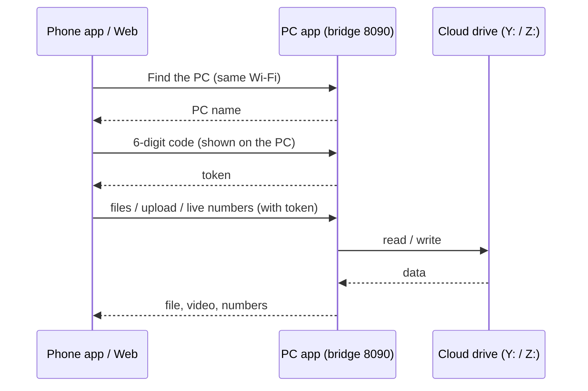

> **Please note:** today the phone works **through the PC**. The PC app must be running and the phone must be on the same Wi-Fi. Reaching the cloud straight from the phone, without the PC, is the next piece of work and is not built yet.

---

<a id="cli"></a>

## 💻 Interactive Terminal CLI (`cloudssd` & `cpx`)

Cloud-SSD provides an interactive, terminal-native Command Line Interface (CLI) accessible directly from Windows Command Prompt (CMD), PowerShell, Windows Terminal, and developer agent sessions (Claude Code / Codex).

### 🚀 Interactive REPL Mode
Open any terminal and simply type:
```cmd
cloudssd
```
*(or use the short alias `cpx`)*

You will be greeted with live vitals, disk sizes, cache status, and an interactive prompt:

```text
============================================================
   Cloud-SSD Terminal CLI  ·  v0.9.0
   Turn your Google Drive into a real drive letter (Y:/Z:)
============================================================
  • Process: PID 20532 (Running)
  • Storage: Y:\ 14.95 TiB  ·  Z:\ 14.95 TiB
  • Cache:   122 GiB available
  • Phone:   vivo I2221 (PAIRED · Online)
============================================================

cloudssd > status
```

### 📋 CLI Commands

| Command | Short | Description |
|---|---|---|
| `status` | `s` | Complete live vitals for PC app, drives, accounts, and phone bridge |
| `phone` | `p` | View connected mobile device details, battery level, and link speed |
| `mounts` | `m` | List all mounted virtual drive letters (`Y:`, `Z:`) and filesystem backends |
| `open <letter>` | `o` | Launch Windows File Explorer directly into the specified drive (e.g. `open Z:`) |
| `remotes` | `r` | List connected Google Drive accounts and storage allocations |
| `cache` | `c` | Inspect SSD cache usage, budget, and read/write bandwidth |
| `clean` | | Purge unpinned temporary cache files to immediately free local SSD space |
| `mirror` | | Check background mirror & offload sync status between PC and cloud |
| `start` / `stop` | | Start or safely dismount Cloud-SSD service and drives |
| `deps` | | Check status of prerequisites (WinFsp, rclone, and Android bridge) |
| `help` | `?` | Display list of supported commands |
| `exit` | `q` | Exit the CLI session |

You can also run one-shot commands from any script or prompt:
```cmd
cloudssd status
cloudssd phone
cloudssd open Z:
```

---

<a id="screenshots"></a>

## 📸 Screenshots

Clean, high-resolution screenshots of both the mobile companion and desktop workstation edition. All captures show actual application screens with zero media/video playback.

### 📱 Part 1: Android Phone App

The Android companion connects securely to your PC over Wi-Fi, allowing you to browse your cloud files, transfer data, and access mirrored copies even when the PC is off.

<div align="center">

| 1. Home Dashboard | 2. Connect & Pair | 3. Cloud SSD Drive |
|:---:|:---:|:---:|
|  |  |  |
| Native card view showing PC drives & quick transfers | 6-digit PIN pairing with desktop app | Browse `Z:` All Accounts & `Y:` Each Account |

<br/>

| 4. Pin Offline Access | 5. Offline Cloud Mirror ("When PC Off") | 6. App Icon Picker |
|:---:|:---:|:---:|
| 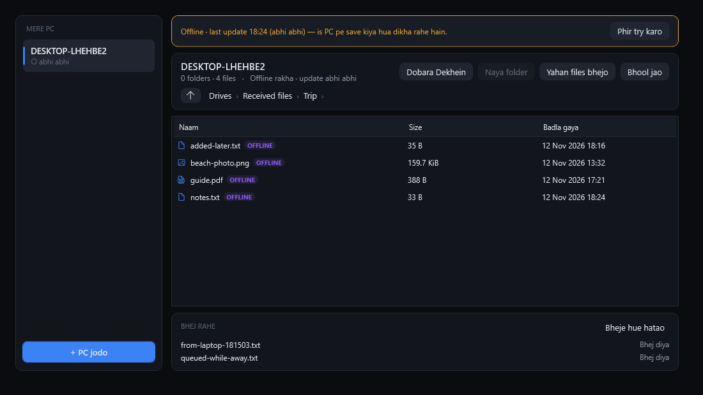 |  |  |
| Pin files & folders offline to open without PC or internet | Access mirrored PC copies in cloud when PC is powered off | Customize mobile app icon (Ocean, Kit, Paper, Sunset) |

<br/>

| 7. Gaming Performance & Remote HUD | 8. 100% Offline Save Vault | 9. App Settings & Languages |
|:---:|:---:|:---:|
|  | 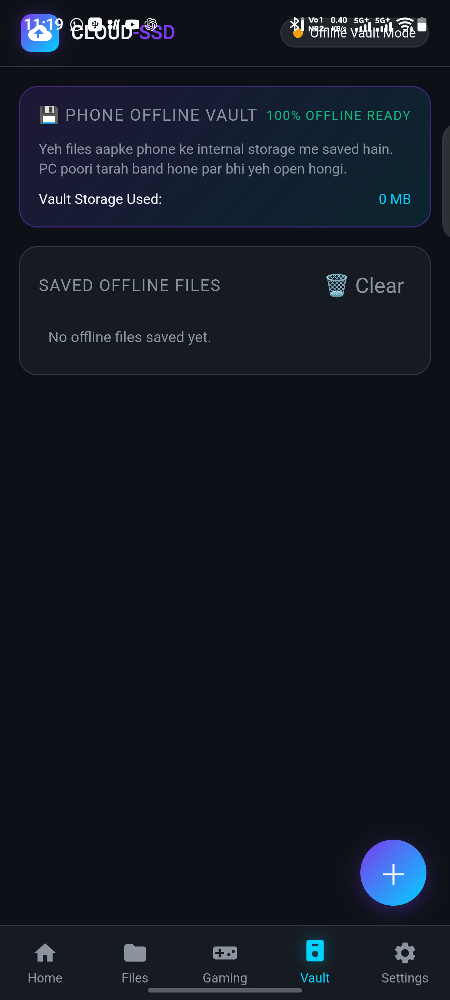 |  |
| Real-time PC stats: FPS, GPU/CPU temps, remote game launch | Secure IndexedDB offline storage for game saves and docs | English, Hindi & Hinglish localization + paired PC list |

<br/>

| 10. Remote Access Allowed | 11. Permission & Security Editor | 12. Remote Pin Offline Kept |
|:---:|:---:|:---:|
| 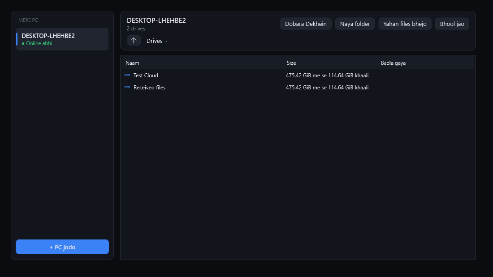 | 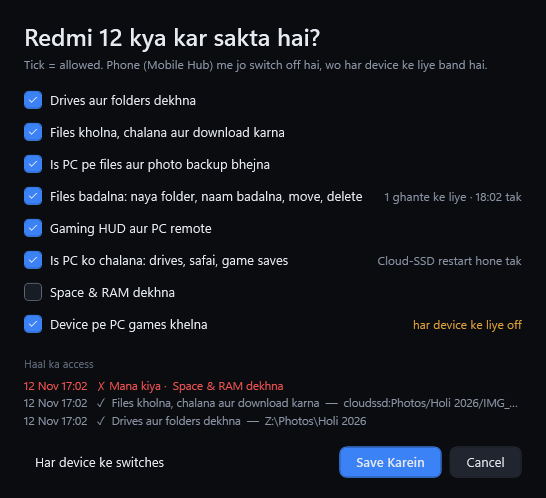 | 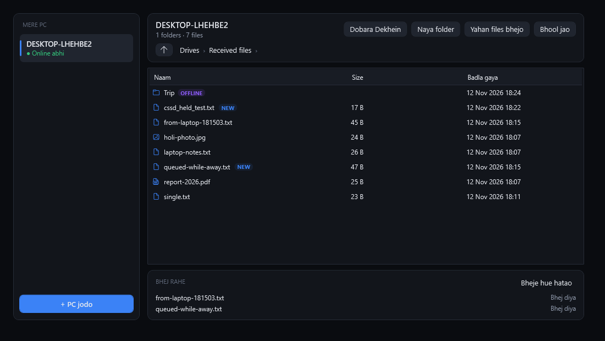 |
| Verified remote connection status from trusted phone | Granular per-device file and drive permission controls | Persistent local pinning indicator on cloud items |

<br/>

| 13. Glow Theme Cards | 14. Kit Theme Cards | 15. Paper Theme Cards |
|:---:|:---:|:---:|
| 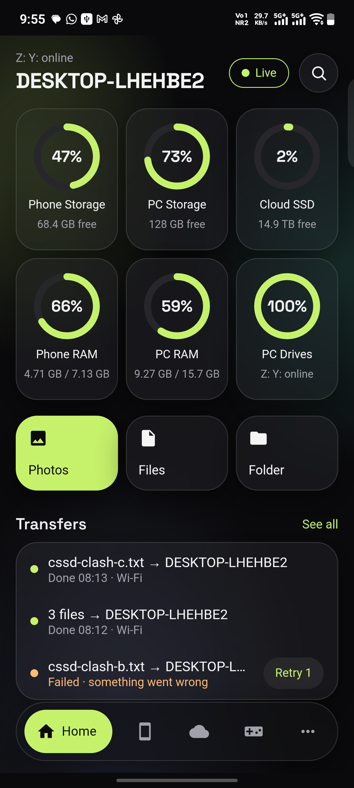 | 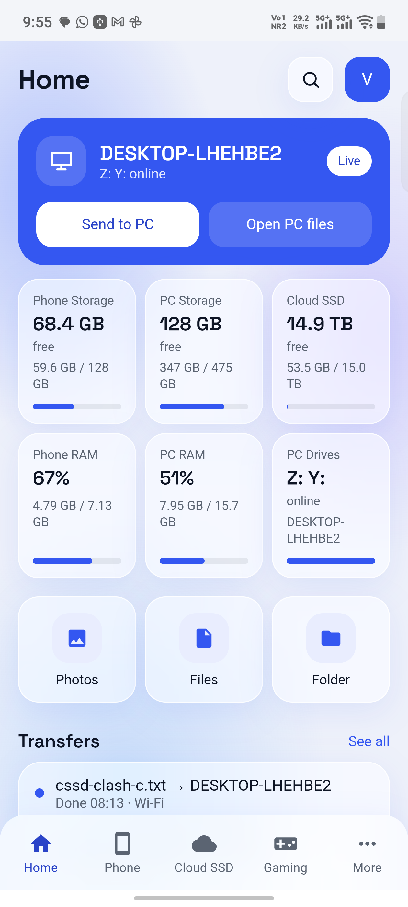 | 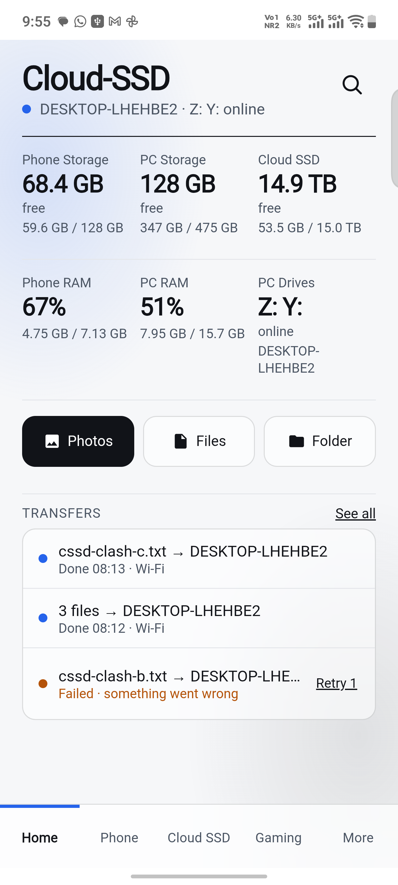 |
| Vibrant neon glowing border and elevation styling | Clean tactile kit styling with subtle borders | Minimalist paper document card presentation |

</div>

---

### 💻 Part 2: Laptop & Desktop PC App

The Windows desktop app manages your Google Drive mount points, RAM caching, smart offloading, and phone connectivity with zero lag.

<div align="center">

| 1. Dashboard Overview | 2. Cloud Drives Manager |
|:---:|:---:|
|  |  |
| Real-time drive health, active accounts, and transfer speeds | Multi-account Google Drive mounting and sync settings |

<br/>

| 3. Devices & Virtual Backup | 4. Mobile Hub & Pairing |
|:---:|:---:|
| 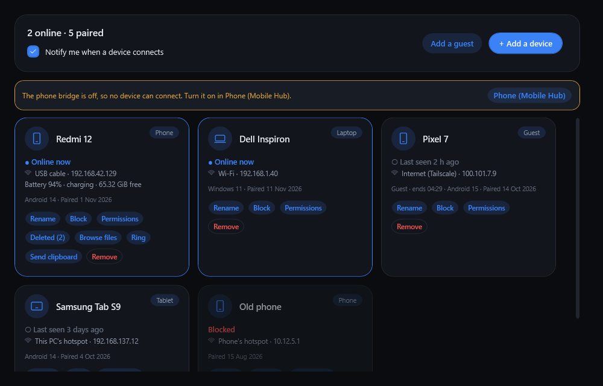 |  |
| Paired phones, remote access rules, and automated PC mirror | QR pairing code, connected phones, and transfer history |

<br/>

| 5. Game Library & Launcher | 6. RAM & Virtual Memory |
|:---:|:---:|
| 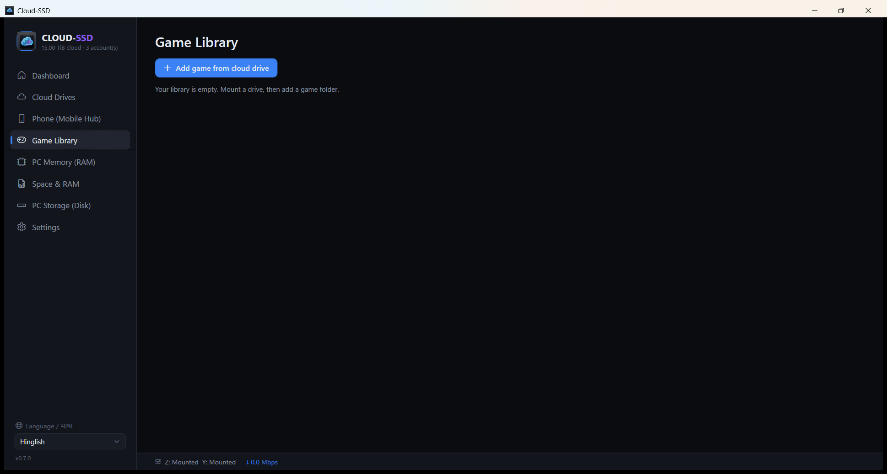 | 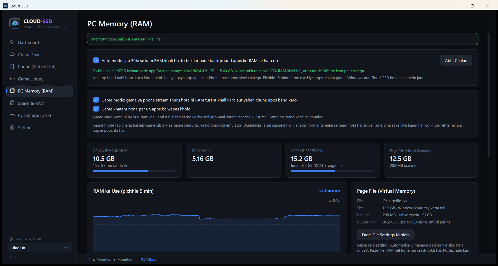 |
| Direct game launcher from cloud disk without full install | High-speed RAM write buffer and read-ahead tuning |

<br/>

| 7. Storage Space Analyzer | 8. Smart Cache Performance |
|:---:|:---:|
|  | 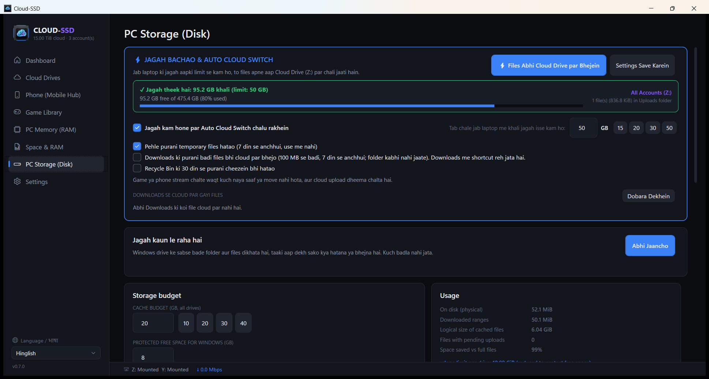 |
| Visual space analyzer showing local vs cloud savings | Intelligent predictive prefetching and cache budgeting |

<br/>

| 9. Desktop App Settings | 10. Live Bell Alerts & Requests |
|:---:|:---:|
| 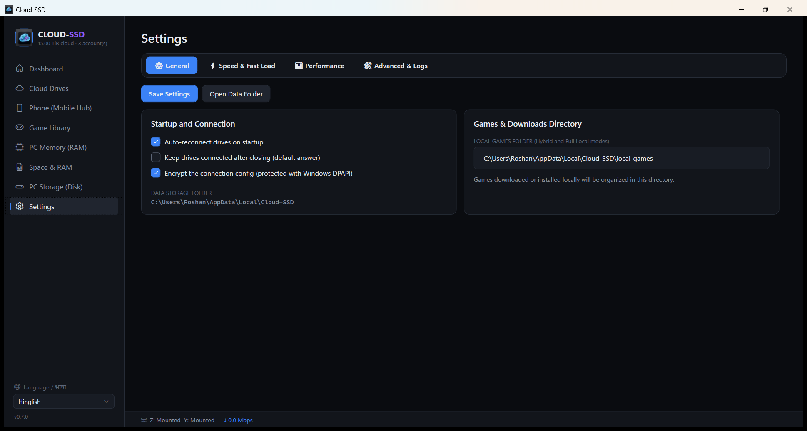 | 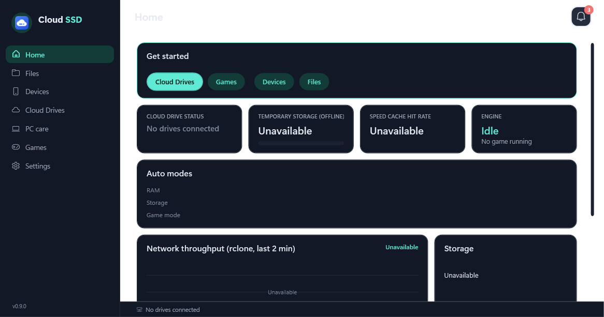 |
| Autostart, dark/light themes, and link preferences | Live popup notifications for incoming phone pairing requests |

</div>

---

<a id="standards"></a>

## 📦 Repository Standards & Delivery Checklist (नियम)

Whenever changes or updates are committed to this repository, the following four rules MUST be strictly followed:

1. **Complete File Upload (सारी फाइल्स अपलोड होंगी):**
   - Every file must be uploaded to GitHub.
   - Files that are directly useful AND intermediate work files, patch scripts, logs, test outputs, and diagnostic tools must all be committed and pushed (`.work/`, tools, scripts, docs). Nothing required for a handover should be omitted.

2. **Backup History Always Included (बैकअप फोल्डर अनिवार्य):**
   - Every task must preserve its dedicated backup directory under `backup/<YYYY-MM-DD_time_task_name>/`.
   - Each backup folder must contain:
     - `before/`: The untouched snapshot of files before changes began.
     - `complete/`: The final verified files with a clear `README.md` explaining what was built, how it works, and verification results.

3. **Updated Structure & Architecture (संरचना व आर्किटेक्चर हमेशा अपडेट):**
   - The repository folder structure, component map, and system architecture diagrams in documentation must always reflect the latest implementation.
   - Any new API endpoints, bridge protocols, or CLI commands must be documented immediately.

4. **Updated Binaries & Installers (EXE और APK हमेशा ताज़ा):**
   - Both the Windows desktop installer/executable (`dist/Cloud-SSD-0.9.0-win-x64.zip` / `releases/Cloud-SSD-setup.exe`) and the Android package (`mobile-android/Cloud-SSD-Mobile.apk`) must be rebuilt and kept up-to-date with every code change.

---

<a id="download"></a>

## 📥 Download

| For | File | Size | |
|---|---|---|---|
| 💻 **Windows PC** | `Cloud-SSD-0.7.0-setup.exe` | 69 MB | [**⬇ Download .exe**](https://github.com/allproject121/Cloud-Drive/raw/main/Cloud-SSD/Cloud-SSD-0.7.0-source/Cloud-SSD/releases/Cloud-SSD-0.7.0-setup.exe) |
| 📱 **Android phone** | `Cloud-SSD-Mobile.apk` | 1.2 MB | [**⬇ Download .apk**](https://github.com/allproject121/Cloud-Drive/raw/main/Cloud-SSD/Cloud-SSD-0.7.0-source/Cloud-SSD/mobile-android/Cloud-SSD-Mobile.apk) |
| 🔒 Checksum for the .exe | `Cloud-SSD-0.7.0-setup.exe.sha256` | — | [View](Cloud-SSD/Cloud-SSD-0.7.0-source/Cloud-SSD/releases/Cloud-SSD-0.7.0-setup.exe.sha256) |

- **Windows:** run the `.exe`. The app is not code-signed, so Windows SmartScreen may warn the first time — choose *More info → Run anyway*.
- **Android:** open the `.apk` on the phone and allow "Install unknown apps" when asked.
- The phone app also ships inside the PC app: while the PC app is running, `http://<PC-IP>:8090/cloudssd.apk` in the phone's browser downloads it too.

---

<a id="setup"></a>

## 🛠️ Setup

### Easiest: let an AI agent do it

The complete setup — from the PC to the phone — is written step by step in one file: **[`SETUP.md`](Cloud-SSD/Cloud-SSD-0.7.0-source/Cloud-SSD/SETUP.md)** (written in Hinglish; the commands are the same in any language).
Open your AI agent (Claude Code, Antigravity, Codex…) in the project folder and tell it:

```text
Read SETUP.md and do the whole setup it describes — PC app, cloud drive and phone app.
You have my full permission. Where my click is needed, tell me in one line what to press.
```

### By hand: 3 + 3 steps

**On the PC**

1. Run [`Cloud-SSD-0.7.0-setup.exe`](https://github.com/allproject121/Cloud-Drive/raw/main/Cloud-SSD/Cloud-SSD-0.7.0-source/Cloud-SSD/releases/Cloud-SSD-0.7.0-setup.exe). If Windows asks about WinFsp, choose **Yes**.
2. Open the app → **Cloud Drives** → **Sign in with Google** → pick your account in the browser and press **Allow**.
3. Drives `Y:` and `Z:` appear in File Explorer. Done.

**On the phone**

1. Install the [APK](https://github.com/allproject121/Cloud-Drive/raw/main/Cloud-SSD/Cloud-SSD-0.7.0-source/Cloud-SSD/mobile-android/Cloud-SSD-Mobile.apk) (or open `http://<PC-IP>:8090` in a browser).
2. Put the phone and the PC on **the same Wi-Fi**.
3. Type the **6-digit code** shown on the PC app's **Mobile Hub** page into the phone.

### Requirements

| Item | Needed |
|---|---|
| PC | Windows 10 (1809+) or 11, 64-bit, NTFS drive |
| Google account | At least one |
| Phone | Android 7.0+ (any browser for the web version) |
| Wi-Fi | Phone and PC on the same network |

If something goes wrong: the ["Dikkat aaye to" (troubleshooting) section of `SETUP.md`](Cloud-SSD/Cloud-SSD-0.7.0-source/Cloud-SSD/SETUP.md#6-dikkat-aaye-to) and [`docs/TROUBLESHOOTING.md`](Cloud-SSD/Cloud-SSD-0.7.0-source/Cloud-SSD/docs/TROUBLESHOOTING.md). To create your own Google key, see [`docs/GOOGLE_DRIVE_SETUP.md`](Cloud-SSD/Cloud-SSD-0.7.0-source/Cloud-SSD/docs/GOOGLE_DRIVE_SETUP.md).

<details>
<summary><b>Developers: build from source</b></summary>

<br/>

```powershell
cd Cloud-SSD\Cloud-SSD-0.7.0-source\Cloud-SSD
powershell -ExecutionPolicy Bypass -File installer\fetch-rclone.ps1      # fetches rclone (checksum-verified)
dotnet build CloudSSD.slnx -c Release
dotnet test tests\CloudSSD.Tests -c Release --no-build                   # unit tests
powershell -ExecutionPolicy Bypass -File installer\build-release.ps1     # zip + setup.exe in dist\
powershell -NoProfile -ExecutionPolicy Bypass -File mobile-android\build-apk.ps1   # phone APK
```

You need: .NET SDK 10, WinFsp, Inno Setup 6 (for the setup.exe), and the Android SDK + JDK 17 (for the APK). Full details are in ["Rasta B" of `SETUP.md`](Cloud-SSD/Cloud-SSD-0.7.0-source/Cloud-SSD/SETUP.md#4-rasta-b--source-code-se-build-developer--naya-build).

</details>

---

<a id="architecture"></a>

## 🏗️ Architecture

The app is written in **.NET 10 (C#)** with a **WPF + MVVM** user interface. It stands on two proven tools — **rclone** (cloud + cache) and **WinFsp** (Windows drive) — and adds its own logic on top: managing mounts, protecting the disk, prediction, games and the phone bridge.

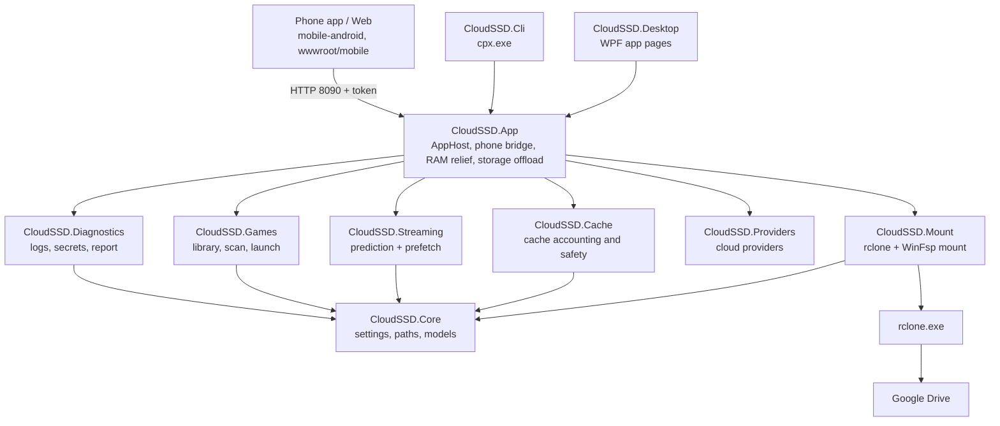

| Project | Responsibility |
|---|---|
| [`CloudSSD.Core`](Cloud-SSD/Cloud-SSD-0.7.0-source/Cloud-SSD/src/CloudSSD.Core) | Settings (JSON), paths, units, models, disk information |
| [`CloudSSD.Mount`](Cloud-SSD/Cloud-SSD-0.7.0-source/Cloud-SSD/src/CloudSSD.Mount) | Finding and running rclone, Google sign-in, mounting / unmounting drives, restart after a crash, reading rclone's log |
| [`CloudSSD.Cache`](Cloud-SSD/Cloud-SSD-0.7.0-source/Cloud-SSD/src/CloudSSD.Cache) | What is in the cache, how much disk is left, safe clean-up |
| [`CloudSSD.Streaming`](Cloud-SSD/Cloud-SSD-0.7.0-source/Cloud-SSD/src/CloudSSD.Streaming) | Predictors, prefetch queue, network governor, a profile per game (SQLite) |
| [`CloudSSD.Games`](Cloud-SSD/Cloud-SSD-0.7.0-source/Cloud-SSD/src/CloudSSD.Games) | Game library, folder scan, compatibility, launcher, Hybrid / Full Local |
| [`CloudSSD.Providers`](Cloud-SSD/Cloud-SSD-0.7.0-source/Cloud-SSD/src/CloudSSD.Providers) | Which cloud providers are supported, and how well |
| [`CloudSSD.Diagnostics`](Cloud-SSD/Cloud-SSD-0.7.0-source/Cloud-SSD/src/CloudSSD.Diagnostics) | Logs, token redaction, DPAPI secret store, report zip |
| [`CloudSSD.App`](Cloud-SSD/Cloud-SSD-0.7.0-source/Cloud-SSD/src/CloudSSD.App) | `AppHost` that ties everything together, phone bridge, RAM relief, storage offload |
| [`CloudSSD.Desktop`](Cloud-SSD/Cloud-SSD-0.7.0-source/Cloud-SSD/src/CloudSSD.Desktop) | WPF window, pages, theme, languages; the phone's web page is also served from here (`wwwroot/mobile`) |
| [`CloudSSD.Cli`](Cloud-SSD/Cloud-SSD-0.7.0-source/Cloud-SSD/src/CloudSSD.Cli) | The `cpx.exe` command-line tool |
| [`CloudSSD.SimCloud`](Cloud-SSD/Cloud-SSD-0.7.0-source/Cloud-SSD/src/CloudSSD.SimCloud) | A fake "slow cloud" server used for tests |
| [`mobile-android`](Cloud-SSD/Cloud-SSD-0.7.0-source/Cloud-SSD/mobile-android) | Android app (WebView + native parts: camera backup, cloud drive in the Files app) |

More detail: [`ARCHITECTURE.md`](Cloud-SSD/Cloud-SSD-0.7.0-source/Cloud-SSD/ARCHITECTURE.md).

### 📊 How fast is it (measured)

Test: loading one level of the demo game, with the "cloud" limited to 70 Mbps. Full report: [`BENCHMARKS.md`](Cloud-SSD/Cloud-SSD-0.7.0-source/Cloud-SSD/BENCHMARKS.md).

| Situation | Load time |
|---|---|
| From the PC's SSD (for comparison) | 0.1 s |
| Plain rclone mount, first time | 56 – 65 s |
| **Cloud Drive, first time** | **20 – 21 s** |
| **Cloud Drive, after Prepare** | **7.7 – 8.2 s** |
| **Cloud Drive, everything cached** | **0.15 – 0.27 s** |

### ⚠️ Honest limits

- Data that is not in the cache arrives at **internet speed** — the first read is never as fast as an SSD.
- Only the demo game has been tested so far; **no commercial game has been tested**. Steam / Epic / anti-cheat games usually need a local install.
- The phone cannot reach the cloud **without the PC** yet.
- The app is not code-signed, so Windows SmartScreen may warn on first start.

Full list: [`KNOWN_LIMITATIONS.md`](Cloud-SSD/Cloud-SSD-0.7.0-source/Cloud-SSD/KNOWN_LIMITATIONS.md).

---

<a id="structure"></a>

## 🗂️ Folder map (click to jump there)

```text
Cloud-Drive
├── README.md                          ← you are here
├── Cloud-SSD
│   ├── Cloud-SSD-0.7.0-source.zip     older source zip
│   └── Cloud-SSD-0.7.0-source
│       ├── Cloud-SSD                  ★ THE PROJECT (the code lives here)
│       │   ├── src                    PC app code (CloudSSD.* projects)
│       │   ├── mobile-android         phone app code + APK
│       │   ├── tests                  unit + integration tests
│       │   ├── benchmarks             speed tests
│       │   ├── installer              scripts that build the setup.exe
│       │   ├── tools                  rclone, WinFsp installer, 5TB scripts
│       │   ├── docs                   guides
│       │   ├── releases               ready-made setup.exe and APK
│       │   └── dist                   build output
│       └── Cloud-SSD-0.7.0-source     copy of older release files
└── Cloud-SSD-5TB                      older PowerShell scripts (the approach used before the app)
```

| Go to | Link |
|---|---|
| ★ The project | [`Cloud-SSD/Cloud-SSD-0.7.0-source/Cloud-SSD`](Cloud-SSD/Cloud-SSD-0.7.0-source/Cloud-SSD) |
| PC app code | [`src`](Cloud-SSD/Cloud-SSD-0.7.0-source/Cloud-SSD/src) |
| Phone app code | [`mobile-android`](Cloud-SSD/Cloud-SSD-0.7.0-source/Cloud-SSD/mobile-android) |
| Phone web page | [`src/CloudSSD.Desktop/wwwroot/mobile`](Cloud-SSD/Cloud-SSD-0.7.0-source/Cloud-SSD/src/CloudSSD.Desktop/wwwroot/mobile) |
| Tests | [`tests`](Cloud-SSD/Cloud-SSD-0.7.0-source/Cloud-SSD/tests) |
| Installer scripts | [`installer`](Cloud-SSD/Cloud-SSD-0.7.0-source/Cloud-SSD/installer) |
| Ready-made downloads | [`releases`](Cloud-SSD/Cloud-SSD-0.7.0-source/Cloud-SSD/releases) |
| Older 5TB scripts | [`Cloud-SSD-5TB`](Cloud-SSD-5TB) · [its README](Cloud-SSD-5TB/README.md) |

---

<a id="docs"></a>

## 📚 All documents

| Document | About |
|---|---|
| [`SETUP.md`](Cloud-SSD/Cloud-SSD-0.7.0-source/Cloud-SSD/SETUP.md) | **The whole setup, step by step** (for an AI agent or by hand; in Hinglish) |
| [`README.md` (project)](Cloud-SSD/Cloud-SSD-0.7.0-source/Cloud-SSD/README.md) | The project's own introduction |
| [`ARCHITECTURE.md`](Cloud-SSD/Cloud-SSD-0.7.0-source/Cloud-SSD/ARCHITECTURE.md) | Internal design and data flows |
| [`BENCHMARKS.md`](Cloud-SSD/Cloud-SSD-0.7.0-source/Cloud-SSD/BENCHMARKS.md) | Speed measurements |
| [`KNOWN_LIMITATIONS.md`](Cloud-SSD/Cloud-SSD-0.7.0-source/Cloud-SSD/KNOWN_LIMITATIONS.md) | What does not work, and why |
| [`COMPATIBILITY.md`](Cloud-SSD/Cloud-SSD-0.7.0-source/Cloud-SSD/COMPATIBILITY.md) | Which games and clouds work |
| [`RAM.md`](Cloud-SSD/Cloud-SSD-0.7.0-source/Cloud-SSD/RAM.md) | Guide to RAM and virtual memory |
| [`docs/GOOGLE_DRIVE_SETUP.md`](Cloud-SSD/Cloud-SSD-0.7.0-source/Cloud-SSD/docs/GOOGLE_DRIVE_SETUP.md) | Connecting Google Drive, creating your own key |
| [`docs/TROUBLESHOOTING.md`](Cloud-SSD/Cloud-SSD-0.7.0-source/Cloud-SSD/docs/TROUBLESHOOTING.md) | Problems and fixes |
| [`docs/GAME_AWARE_PROTOCOL.md`](Cloud-SSD/Cloud-SSD-0.7.0-source/Cloud-SSD/docs/GAME_AWARE_PROTOCOL.md) | Protocol for getting hints straight from a game |
| [`SECURITY.md`](Cloud-SSD/Cloud-SSD-0.7.0-source/Cloud-SSD/SECURITY.md) | Security policy |
| [`CONTRIBUTING.md`](Cloud-SSD/Cloud-SSD-0.7.0-source/Cloud-SSD/CONTRIBUTING.md) | How to contribute code |
| [`THIRD_PARTY_NOTICES.md`](Cloud-SSD/Cloud-SSD-0.7.0-source/Cloud-SSD/THIRD_PARTY_NOTICES.md) | Licenses of rclone, WinFsp and others |

---

<a id="feedback"></a>

## 💬 Send feedback

<div align="center">
<table>
<tr>
<td align="center" width="640">

<h3>Have an idea to make it better? Tell us 🙏</h3>

Want a new feature, found something confusing, or something did not work?<br/>
Press the button below — a small form opens where you can write and send it.

<br/><br/>

<a href="https://github.com/allproject121/Cloud-Drive/issues/new?template=improvement.yml">

</a>

<br/><br/>

<sub>You need to be signed in to GitHub. Suggestions already sent are listed <a href="https://github.com/allproject121/Cloud-Drive/issues">here</a>.</sub>

</td>
</tr>
</table>
</div>

---

<div align="center">

Cloud-SSD contributors · [MIT License](Cloud-SSD/Cloud-SSD-0.7.0-source/Cloud-SSD/LICENSE)

</div>
