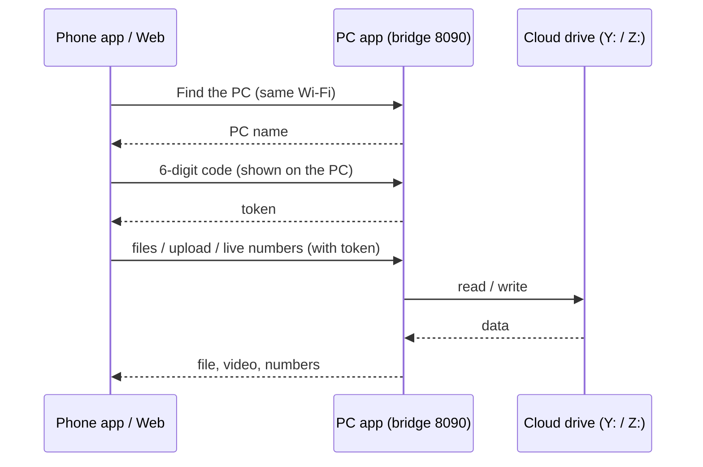
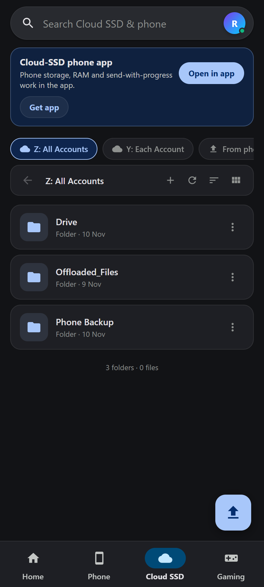
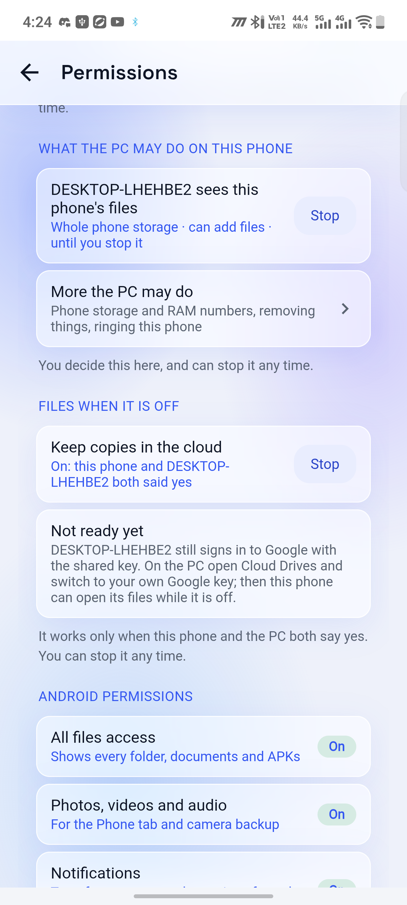
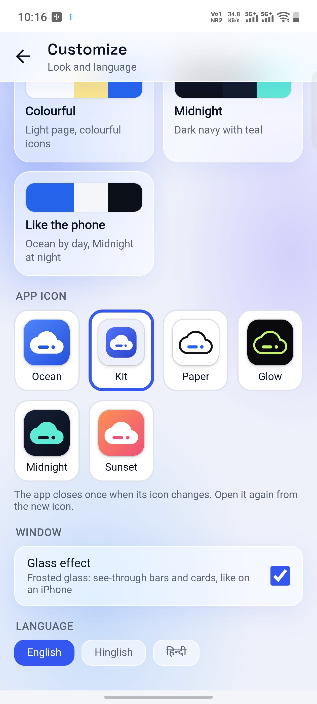
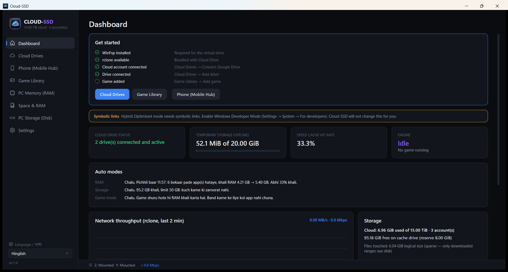
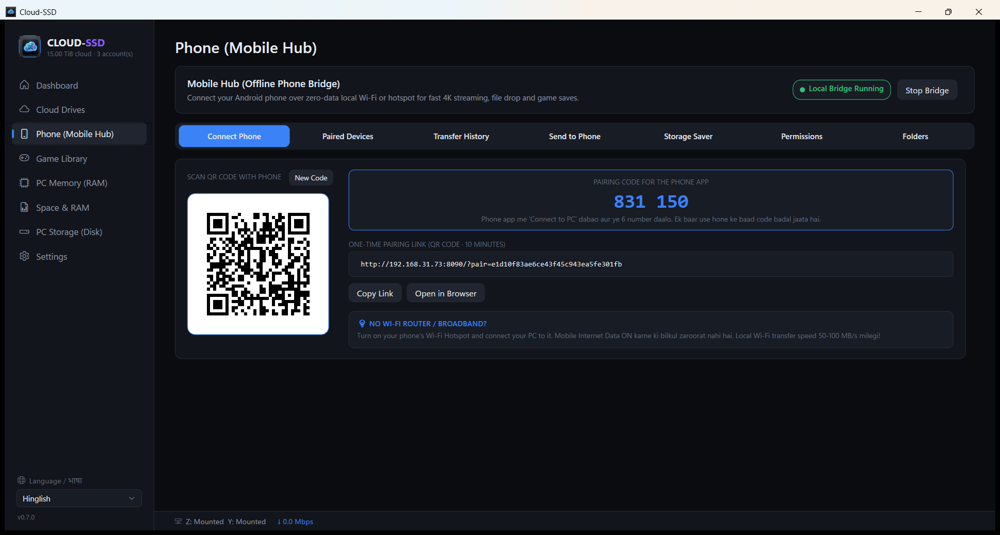
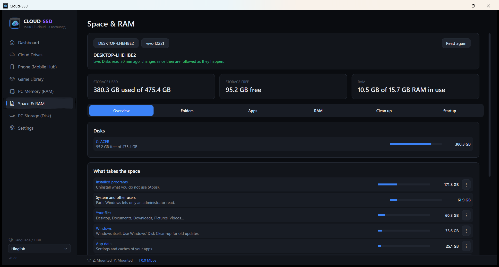
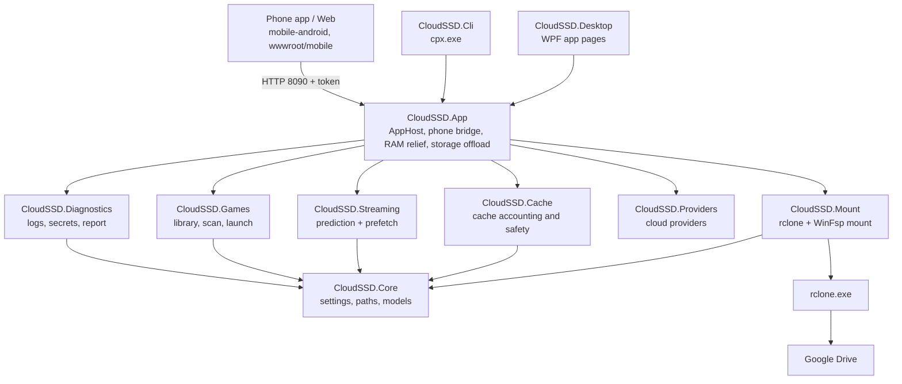

<div align="center">


# Cloud Drive (Cloud-SSD)

**Turn your Google Drive into a real drive on your PC — and use it from your phone too.**

Keep big games and files in the cloud, keep your SSD free, and open everything from `Z:` as if it were stored on the PC.

[](#setup)
[](#phone)
[](#architecture)
[](#how)
[](#download)
[](#download)
[](Cloud-SSD/Cloud-SSD-0.7.0-source/Cloud-SSD/LICENSE)

<br/>

<a href="https://github.com/allproject121/Cloud-Drive/raw/main/Cloud-SSD/Cloud-SSD-0.7.0-source/Cloud-SSD/releases/Cloud-SSD-0.7.0-setup.exe">

</a>
&nbsp;&nbsp;
<a href="https://github.com/allproject121/Cloud-Drive/raw/main/Cloud-SSD/Cloud-SSD-0.7.0-source/Cloud-SSD/mobile-android/Cloud-SSD-Mobile.apk">

</a>

<br/><br/>

[What it does](#what) • [How it works](#how) • [Features](#features) • [CLI Terminal](#cli) • [Phone & Web](#phone) • [Screenshots](#screenshots) • [Repository Standards](#standards) • [Download](#download) • [Setup](#setup) • [Architecture](#architecture) • [Folder map](#structure) • [Docs](#docs) • [Send feedback](#feedback)

</div>

---

<a id="what"></a>

## 🧐 What it does

Cloud Drive connects your **Google Drive account** to Windows as a **real drive letter** (`Y:` / `Z:`). File Explorer, games and every other app see it as a normal hard disk.

| Your problem | What Cloud Drive does |
|---|---|
| The PC's SSD is full | Files stay in the cloud; only the part you need right now comes to the PC |
| A 100 GB game must be downloaded completely | The game downloads only the pieces it actually reads |
| One Google account does not have enough space | Several accounts are joined into **one big drive** |
| The phone is low on storage | Send photos and files from the phone straight to the cloud drive |
| You want your PC's files on the phone | Open the cloud drive in the phone app or a browser and play videos directly |

> **This is not cloud gaming.** The game runs on your own PC's CPU and GPU. Cloud Drive connects *storage* to the cloud — it does not stream video.

---

<a id="how"></a>

## ⚙️ How it works


1. **rclone** talks to Google Drive. It downloads only the requested part of a file (a byte range), never the whole file.
2. **WinFsp** shows that data to Windows as a drive letter. There is no kernel driver, and administrator rights are needed only once, to install WinFsp.
3. Every part that has been downloaded stays in the **SSD cache**, so opening it again is instant. You choose the cache limit, and some space on C: is always kept free.
4. The **prediction engine** learns in which order a game reads its data and fetches that data ahead of time on the next launch ("Optimize & Prepare").
5. The **phone bridge** is a small local server on the PC. The phone app and the web page connect to it — inside your own Wi-Fi only, with no outside server.

---

<a id="features"></a>

## ✨ Features

### 💻 PC app (Windows)

| Feature | What you get |
|---|---|
| **Two cloud drives** | **Each Account** (`Y:`) — one folder per Google account. **All Accounts** (`Z:`) — all accounts joined into one big drive |
| **Many accounts** | Connect as many Google accounts as you like; each one is listed with its Gmail address and free space |
| **Smart Cache** | A cache size limit, protected free space on C:, and only the parts that were read take up disk space (sparse files) |
| **Game Library** | 3 modes: **Cloud Direct** (run from the drive), **Hybrid** (exe/dll on the PC, big data from the cloud), **Full Local** (copy everything) |
| **Optimize & Prepare** | Downloads a game's startup data before you press Play |
| **PC Memory (RAM)** | Shows memory health; when less than 30% RAM is free it trims the memory of idle background apps on its own |
| **Storage auto mode** | When the PC runs low on space, files uploaded from the phone are moved to the cloud drive |
| **Mobile Hub** | Pairing code / QR for the phone, the list of connected phones, and switches for what a phone may do |
| **Diagnostics** | Status of everything the app needs, logs, and a "sanitized report" that contains no logins or tokens |
| **Languages** | English, Hindi, Hinglish |
| **`cpx` command** | Checks and mounting without a window: `cpx deps`, `cpx remotes`, `cpx mounts` |

### 🔒 Security

- Your Google password is never typed into the app — sign-in happens on Google's own page.
- The saved login is stored encrypted on the PC (Windows DPAPI).
- The phone bridge listens on the local Wi-Fi only, and every request must carry the pairing token.
- The app runs without administrator rights and does not change Windows security settings.

---

<a id="phone"></a>

## 📱 Phone app and 🌐 Web

There are two ways to use it on a phone, and both show the same thing:

| | **Android app** | **Web (browser)** |
|---|---|---|
| How to open it | Install the APK | Open `http://<PC-IP>:8090` in a browser |
| Where it runs | Android 7.0+ | Any phone, tablet or second laptop on the same Wi-Fi |
| Home-screen icon | Yes | Yes ("Install on Home Screen" — PWA) |
| Automatic camera backup | Yes | No |
| Cloud drive inside the phone's Files app | Yes | No |

### What you can do from the phone

| Section | What it does |
|---|---|
| **Cloud SSD** | Browse the PC's cloud drive, open / download files, create folders, rename / move / delete |
| **Send to PC** | Send photos or any file from the phone to the cloud drive; a transfer list shows progress |
| **Camera backup** | New photos and videos go to `Phone Backup/<phone>/Camera/<year-month>` automatically |
| **Media** | Videos and audio play directly, without downloading the whole file first |
| **Gaming companion** | Live numbers from the PC: CPU, GPU, RAM, cloud read MB/s, cache hits, Wi-Fi latency; game save backups |
| **PC media remote** | Mute, Previous, Play / Pause, Next |
| **Laptop Space Saver** | Free up space on the PC from the phone |
| **This phone** | The phone's RAM and storage, and the phone's files by category |
| **Languages** | English, Hindi, Hinglish |

### How the phone connects to the PC



> **Please note:** today the phone works **through the PC**. The PC app must be running and the phone must be on the same Wi-Fi. Reaching the cloud straight from the phone, without the PC, is the next piece of work and is not built yet.

---

<a id="cli"></a>

## 💻 Interactive Terminal CLI (`cloudssd` & `cpx`)

Cloud-SSD provides an interactive, terminal-native Command Line Interface (CLI) accessible directly from Windows Command Prompt (CMD), PowerShell, Windows Terminal, and developer agent sessions (Claude Code / Codex).

### 🚀 Interactive REPL Mode
Open any terminal and simply type:
```cmd
cloudssd
```
*(or use the short alias `cpx`)*

You will be greeted with live vitals, disk sizes, cache status, and an interactive prompt:

```text
============================================================
   Cloud-SSD Terminal CLI  ·  v0.9.0
   Turn your Google Drive into a real drive letter (Y:/Z:)
============================================================
  • Process: PID 20532 (Running)
  • Storage: Y:\ 14.95 TiB  ·  Z:\ 14.95 TiB
  • Cache:   122 GiB available
  • Phone:   vivo I2221 (PAIRED · Online)
============================================================

cloudssd > status
```

### 📋 CLI Commands

| Command | Short | Description |
|---|---|---|
| `status` | `s` | Complete live vitals for PC app, drives, accounts, and phone bridge |
| `phone` | `p` | View connected mobile device details, battery level, and link speed |
| `mounts` | `m` | List all mounted virtual drive letters (`Y:`, `Z:`) and filesystem backends |
| `open <letter>` | `o` | Launch Windows File Explorer directly into the specified drive (e.g. `open Z:`) |
| `remotes` | `r` | List connected Google Drive accounts and storage allocations |
| `cache` | `c` | Inspect SSD cache usage, budget, and read/write bandwidth |
| `clean` | | Purge unpinned temporary cache files to immediately free local SSD space |
| `mirror` | | Check background mirror & offload sync status between PC and cloud |
| `start` / `stop` | | Start or safely dismount Cloud-SSD service and drives |
| `deps` | | Check status of prerequisites (WinFsp, rclone, and Android bridge) |
| `help` | `?` | Display list of supported commands |
| `exit` | `q` | Exit the CLI session |

You can also run one-shot commands from any script or prompt:
```cmd
cloudssd status
cloudssd phone
cloudssd open Z:
```

---

<a id="screenshots"></a>

## 📸 Screenshots

Clean, high-resolution screenshots of both the mobile companion and desktop workstation edition. All captures show actual application screens with zero media/video playback.

### 📱 Part 1: Android Phone App

The Android companion connects securely to your PC over Wi-Fi, allowing you to browse your cloud files, transfer data, and access mirrored copies even when the PC is off.

<div align="center">

| 1. Home Dashboard | 2. Connect & Pair | 3. Cloud SSD Drive |
|:---:|:---:|:---:|
|  |  |  |
| Native card view showing PC drives & quick transfers | 6-digit PIN pairing with desktop app | Browse `Z:` All Accounts & `Y:` Each Account |

<br/>

| 4. Offline Access ("When PC is Off") | 5. Visual Theme Effects | 6. App Icon Picker |
|:---:|:---:|:---:|
|  |  |  |
| Access mirrored PC copies in cloud when PC is powered off | Modern UI cards with Glow, Kit, & Paper styling | Customize mobile app icon (Ocean, Kit, Paper, Sunset) |

</div>

---

### 💻 Part 2: Laptop & Desktop PC App

The Windows desktop app manages your Google Drive mount points, RAM caching, smart offloading, and phone connectivity with zero lag.

<div align="center">

| 1. Dashboard Overview | 2. Cloud Drives Manager |
|:---:|:---:|
|  |  |
| Real-time drive health, active accounts, and transfer speeds | Multi-account Google Drive mounting and sync settings |

<br/>

| 3. Mobile Hub | 4. Game Library & Launcher |
|:---:|:---:|
|  |  |
| QR pairing code, connected phones, and transfer history | Direct game launcher from cloud disk without full install |

<br/>

| 5. RAM & Virtual Memory | 6. Storage Space Analyzer |
|:---:|:---:|
|  |  |
| High-speed RAM write buffer and read-ahead tuning | Visual space analyzer showing local vs cloud savings |

<br/>

| 7. Smart Cache Performance | 8. Desktop App Settings |
|:---:|:---:|
|  |  |
| Intelligent predictive prefetching and cache budgeting | Autostart, dark/light themes, and link preferences |

</div>

---

<a id="standards"></a>

## 📦 Repository Standards & Delivery Checklist (नियम)

Whenever changes or updates are committed to this repository, the following four rules MUST be strictly followed:

1. **Complete File Upload (सारी फाइल्स अपलोड होंगी):**
   - Every file must be uploaded to GitHub.
   - Files that are directly useful AND intermediate work files, patch scripts, logs, test outputs, and diagnostic tools must all be committed and pushed (`.work/`, tools, scripts, docs). Nothing required for a handover should be omitted.

2. **Backup History Always Included (बैकअप फोल्डर अनिवार्य):**
   - Every task must preserve its dedicated backup directory under `backup/<YYYY-MM-DD_time_task_name>/`.
   - Each backup folder must contain:
     - `before/`: The untouched snapshot of files before changes began.
     - `complete/`: The final verified files with a clear `README.md` explaining what was built, how it works, and verification results.

3. **Updated Structure & Architecture (संरचना व आर्किटेक्चर हमेशा अपडेट):**
   - The repository folder structure, component map, and system architecture diagrams in documentation must always reflect the latest implementation.
   - Any new API endpoints, bridge protocols, or CLI commands must be documented immediately.

4. **Updated Binaries & Installers (EXE और APK हमेशा ताज़ा):**
   - Both the Windows desktop installer/executable (`dist/Cloud-SSD-0.9.0-win-x64.zip` / `releases/Cloud-SSD-setup.exe`) and the Android package (`mobile-android/Cloud-SSD-Mobile.apk`) must be rebuilt and kept up-to-date with every code change.

---

<a id="download"></a>

## 📥 Download

| For | File | Size | |
|---|---|---|---|
| 💻 **Windows PC** | `Cloud-SSD-0.7.0-setup.exe` | 69 MB | [**⬇ Download .exe**](https://github.com/allproject121/Cloud-Drive/raw/main/Cloud-SSD/Cloud-SSD-0.7.0-source/Cloud-SSD/releases/Cloud-SSD-0.7.0-setup.exe) |
| 📱 **Android phone** | `Cloud-SSD-Mobile.apk` | 1.2 MB | [**⬇ Download .apk**](https://github.com/allproject121/Cloud-Drive/raw/main/Cloud-SSD/Cloud-SSD-0.7.0-source/Cloud-SSD/mobile-android/Cloud-SSD-Mobile.apk) |
| 🔒 Checksum for the .exe | `Cloud-SSD-0.7.0-setup.exe.sha256` | — | [View](Cloud-SSD/Cloud-SSD-0.7.0-source/Cloud-SSD/releases/Cloud-SSD-0.7.0-setup.exe.sha256) |

- **Windows:** run the `.exe`. The app is not code-signed, so Windows SmartScreen may warn the first time — choose *More info → Run anyway*.
- **Android:** open the `.apk` on the phone and allow "Install unknown apps" when asked.
- The phone app also ships inside the PC app: while the PC app is running, `http://<PC-IP>:8090/cloudssd.apk` in the phone's browser downloads it too.

---

<a id="setup"></a>

## 🛠️ Setup

### Easiest: let an AI agent do it

The complete setup — from the PC to the phone — is written step by step in one file: **[`SETUP.md`](Cloud-SSD/Cloud-SSD-0.7.0-source/Cloud-SSD/SETUP.md)** (written in Hinglish; the commands are the same in any language).
Open your AI agent (Claude Code, Antigravity, Codex…) in the project folder and tell it:

```text
Read SETUP.md and do the whole setup it describes — PC app, cloud drive and phone app.
You have my full permission. Where my click is needed, tell me in one line what to press.
```

### By hand: 3 + 3 steps

**On the PC**

1. Run [`Cloud-SSD-0.7.0-setup.exe`](https://github.com/allproject121/Cloud-Drive/raw/main/Cloud-SSD/Cloud-SSD-0.7.0-source/Cloud-SSD/releases/Cloud-SSD-0.7.0-setup.exe). If Windows asks about WinFsp, choose **Yes**.
2. Open the app → **Cloud Drives** → **Sign in with Google** → pick your account in the browser and press **Allow**.
3. Drives `Y:` and `Z:` appear in File Explorer. Done.

**On the phone**

1. Install the [APK](https://github.com/allproject121/Cloud-Drive/raw/main/Cloud-SSD/Cloud-SSD-0.7.0-source/Cloud-SSD/mobile-android/Cloud-SSD-Mobile.apk) (or open `http://<PC-IP>:8090` in a browser).
2. Put the phone and the PC on **the same Wi-Fi**.
3. Type the **6-digit code** shown on the PC app's **Mobile Hub** page into the phone.

### Requirements

| Item | Needed |
|---|---|
| PC | Windows 10 (1809+) or 11, 64-bit, NTFS drive |
| Google account | At least one |
| Phone | Android 7.0+ (any browser for the web version) |
| Wi-Fi | Phone and PC on the same network |

If something goes wrong: the ["Dikkat aaye to" (troubleshooting) section of `SETUP.md`](Cloud-SSD/Cloud-SSD-0.7.0-source/Cloud-SSD/SETUP.md#6-dikkat-aaye-to) and [`docs/TROUBLESHOOTING.md`](Cloud-SSD/Cloud-SSD-0.7.0-source/Cloud-SSD/docs/TROUBLESHOOTING.md). To create your own Google key, see [`docs/GOOGLE_DRIVE_SETUP.md`](Cloud-SSD/Cloud-SSD-0.7.0-source/Cloud-SSD/docs/GOOGLE_DRIVE_SETUP.md).

<details>
<summary><b>Developers: build from source</b></summary>

<br/>

```powershell
cd Cloud-SSD\Cloud-SSD-0.7.0-source\Cloud-SSD
powershell -ExecutionPolicy Bypass -File installer\fetch-rclone.ps1      # fetches rclone (checksum-verified)
dotnet build CloudSSD.slnx -c Release
dotnet test tests\CloudSSD.Tests -c Release --no-build                   # unit tests
powershell -ExecutionPolicy Bypass -File installer\build-release.ps1     # zip + setup.exe in dist\
powershell -NoProfile -ExecutionPolicy Bypass -File mobile-android\build-apk.ps1   # phone APK
```

You need: .NET SDK 10, WinFsp, Inno Setup 6 (for the setup.exe), and the Android SDK + JDK 17 (for the APK). Full details are in ["Rasta B" of `SETUP.md`](Cloud-SSD/Cloud-SSD-0.7.0-source/Cloud-SSD/SETUP.md#4-rasta-b--source-code-se-build-developer--naya-build).

</details>

---

<a id="architecture"></a>

## 🏗️ Architecture

The app is written in **.NET 10 (C#)** with a **WPF + MVVM** user interface. It stands on two proven tools — **rclone** (cloud + cache) and **WinFsp** (Windows drive) — and adds its own logic on top: managing mounts, protecting the disk, prediction, games and the phone bridge.



| Project | Responsibility |
|---|---|
| [`CloudSSD.Core`](Cloud-SSD/Cloud-SSD-0.7.0-source/Cloud-SSD/src/CloudSSD.Core) | Settings (JSON), paths, units, models, disk information |
| [`CloudSSD.Mount`](Cloud-SSD/Cloud-SSD-0.7.0-source/Cloud-SSD/src/CloudSSD.Mount) | Finding and running rclone, Google sign-in, mounting / unmounting drives, restart after a crash, reading rclone's log |
| [`CloudSSD.Cache`](Cloud-SSD/Cloud-SSD-0.7.0-source/Cloud-SSD/src/CloudSSD.Cache) | What is in the cache, how much disk is left, safe clean-up |
| [`CloudSSD.Streaming`](Cloud-SSD/Cloud-SSD-0.7.0-source/Cloud-SSD/src/CloudSSD.Streaming) | Predictors, prefetch queue, network governor, a profile per game (SQLite) |
| [`CloudSSD.Games`](Cloud-SSD/Cloud-SSD-0.7.0-source/Cloud-SSD/src/CloudSSD.Games) | Game library, folder scan, compatibility, launcher, Hybrid / Full Local |
| [`CloudSSD.Providers`](Cloud-SSD/Cloud-SSD-0.7.0-source/Cloud-SSD/src/CloudSSD.Providers) | Which cloud providers are supported, and how well |
| [`CloudSSD.Diagnostics`](Cloud-SSD/Cloud-SSD-0.7.0-source/Cloud-SSD/src/CloudSSD.Diagnostics) | Logs, token redaction, DPAPI secret store, report zip |
| [`CloudSSD.App`](Cloud-SSD/Cloud-SSD-0.7.0-source/Cloud-SSD/src/CloudSSD.App) | `AppHost` that ties everything together, phone bridge, RAM relief, storage offload |
| [`CloudSSD.Desktop`](Cloud-SSD/Cloud-SSD-0.7.0-source/Cloud-SSD/src/CloudSSD.Desktop) | WPF window, pages, theme, languages; the phone's web page is also served from here (`wwwroot/mobile`) |
| [`CloudSSD.Cli`](Cloud-SSD/Cloud-SSD-0.7.0-source/Cloud-SSD/src/CloudSSD.Cli) | The `cpx.exe` command-line tool |
| [`CloudSSD.SimCloud`](Cloud-SSD/Cloud-SSD-0.7.0-source/Cloud-SSD/src/CloudSSD.SimCloud) | A fake "slow cloud" server used for tests |
| [`mobile-android`](Cloud-SSD/Cloud-SSD-0.7.0-source/Cloud-SSD/mobile-android) | Android app (WebView + native parts: camera backup, cloud drive in the Files app) |

More detail: [`ARCHITECTURE.md`](Cloud-SSD/Cloud-SSD-0.7.0-source/Cloud-SSD/ARCHITECTURE.md).

### 📊 How fast is it (measured)

Test: loading one level of the demo game, with the "cloud" limited to 70 Mbps. Full report: [`BENCHMARKS.md`](Cloud-SSD/Cloud-SSD-0.7.0-source/Cloud-SSD/BENCHMARKS.md).

| Situation | Load time |
|---|---|
| From the PC's SSD (for comparison) | 0.1 s |
| Plain rclone mount, first time | 56 – 65 s |
| **Cloud Drive, first time** | **20 – 21 s** |
| **Cloud Drive, after Prepare** | **7.7 – 8.2 s** |
| **Cloud Drive, everything cached** | **0.15 – 0.27 s** |

### ⚠️ Honest limits

- Data that is not in the cache arrives at **internet speed** — the first read is never as fast as an SSD.
- Only the demo game has been tested so far; **no commercial game has been tested**. Steam / Epic / anti-cheat games usually need a local install.
- The phone cannot reach the cloud **without the PC** yet.
- The app is not code-signed, so Windows SmartScreen may warn on first start.

Full list: [`KNOWN_LIMITATIONS.md`](Cloud-SSD/Cloud-SSD-0.7.0-source/Cloud-SSD/KNOWN_LIMITATIONS.md).

---

<a id="structure"></a>

## 🗂️ Folder map (click to jump there)

```text
Cloud-Drive
├── README.md                          ← you are here
├── Cloud-SSD
│   ├── Cloud-SSD-0.7.0-source.zip     older source zip
│   └── Cloud-SSD-0.7.0-source
│       ├── Cloud-SSD                  ★ THE PROJECT (the code lives here)
│       │   ├── src                    PC app code (CloudSSD.* projects)
│       │   ├── mobile-android         phone app code + APK
│       │   ├── tests                  unit + integration tests
│       │   ├── benchmarks             speed tests
│       │   ├── installer              scripts that build the setup.exe
│       │   ├── tools                  rclone, WinFsp installer, 5TB scripts
│       │   ├── docs                   guides
│       │   ├── releases               ready-made setup.exe and APK
│       │   └── dist                   build output
│       └── Cloud-SSD-0.7.0-source     copy of older release files
└── Cloud-SSD-5TB                      older PowerShell scripts (the approach used before the app)
```

| Go to | Link |
|---|---|
| ★ The project | [`Cloud-SSD/Cloud-SSD-0.7.0-source/Cloud-SSD`](Cloud-SSD/Cloud-SSD-0.7.0-source/Cloud-SSD) |
| PC app code | [`src`](Cloud-SSD/Cloud-SSD-0.7.0-source/Cloud-SSD/src) |
| Phone app code | [`mobile-android`](Cloud-SSD/Cloud-SSD-0.7.0-source/Cloud-SSD/mobile-android) |
| Phone web page | [`src/CloudSSD.Desktop/wwwroot/mobile`](Cloud-SSD/Cloud-SSD-0.7.0-source/Cloud-SSD/src/CloudSSD.Desktop/wwwroot/mobile) |
| Tests | [`tests`](Cloud-SSD/Cloud-SSD-0.7.0-source/Cloud-SSD/tests) |
| Installer scripts | [`installer`](Cloud-SSD/Cloud-SSD-0.7.0-source/Cloud-SSD/installer) |
| Ready-made downloads | [`releases`](Cloud-SSD/Cloud-SSD-0.7.0-source/Cloud-SSD/releases) |
| Older 5TB scripts | [`Cloud-SSD-5TB`](Cloud-SSD-5TB) · [its README](Cloud-SSD-5TB/README.md) |

---

<a id="docs"></a>

## 📚 All documents

| Document | About |
|---|---|
| [`SETUP.md`](Cloud-SSD/Cloud-SSD-0.7.0-source/Cloud-SSD/SETUP.md) | **The whole setup, step by step** (for an AI agent or by hand; in Hinglish) |
| [`README.md` (project)](Cloud-SSD/Cloud-SSD-0.7.0-source/Cloud-SSD/README.md) | The project's own introduction |
| [`ARCHITECTURE.md`](Cloud-SSD/Cloud-SSD-0.7.0-source/Cloud-SSD/ARCHITECTURE.md) | Internal design and data flows |
| [`BENCHMARKS.md`](Cloud-SSD/Cloud-SSD-0.7.0-source/Cloud-SSD/BENCHMARKS.md) | Speed measurements |
| [`KNOWN_LIMITATIONS.md`](Cloud-SSD/Cloud-SSD-0.7.0-source/Cloud-SSD/KNOWN_LIMITATIONS.md) | What does not work, and why |
| [`COMPATIBILITY.md`](Cloud-SSD/Cloud-SSD-0.7.0-source/Cloud-SSD/COMPATIBILITY.md) | Which games and clouds work |
| [`RAM.md`](Cloud-SSD/Cloud-SSD-0.7.0-source/Cloud-SSD/RAM.md) | Guide to RAM and virtual memory |
| [`docs/GOOGLE_DRIVE_SETUP.md`](Cloud-SSD/Cloud-SSD-0.7.0-source/Cloud-SSD/docs/GOOGLE_DRIVE_SETUP.md) | Connecting Google Drive, creating your own key |
| [`docs/TROUBLESHOOTING.md`](Cloud-SSD/Cloud-SSD-0.7.0-source/Cloud-SSD/docs/TROUBLESHOOTING.md) | Problems and fixes |
| [`docs/GAME_AWARE_PROTOCOL.md`](Cloud-SSD/Cloud-SSD-0.7.0-source/Cloud-SSD/docs/GAME_AWARE_PROTOCOL.md) | Protocol for getting hints straight from a game |
| [`SECURITY.md`](Cloud-SSD/Cloud-SSD-0.7.0-source/Cloud-SSD/SECURITY.md) | Security policy |
| [`CONTRIBUTING.md`](Cloud-SSD/Cloud-SSD-0.7.0-source/Cloud-SSD/CONTRIBUTING.md) | How to contribute code |
| [`THIRD_PARTY_NOTICES.md`](Cloud-SSD/Cloud-SSD-0.7.0-source/Cloud-SSD/THIRD_PARTY_NOTICES.md) | Licenses of rclone, WinFsp and others |

---

<a id="feedback"></a>

## 💬 Send feedback

<div align="center">
<table>
<tr>
<td align="center" width="640">

<h3>Have an idea to make it better? Tell us 🙏</h3>

Want a new feature, found something confusing, or something did not work?<br/>
Press the button below — a small form opens where you can write and send it.

<br/><br/>

<a href="https://github.com/allproject121/Cloud-Drive/issues/new?template=improvement.yml">

</a>

<br/><br/>

<sub>You need to be signed in to GitHub. Suggestions already sent are listed <a href="https://github.com/allproject121/Cloud-Drive/issues">here</a>.</sub>

</td>
</tr>
</table>
</div>

---

<div align="center">

Cloud-SSD contributors · [MIT License](Cloud-SSD/Cloud-SSD-0.7.0-source/Cloud-SSD/LICENSE)

</div>
